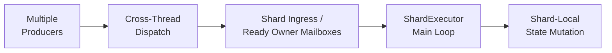
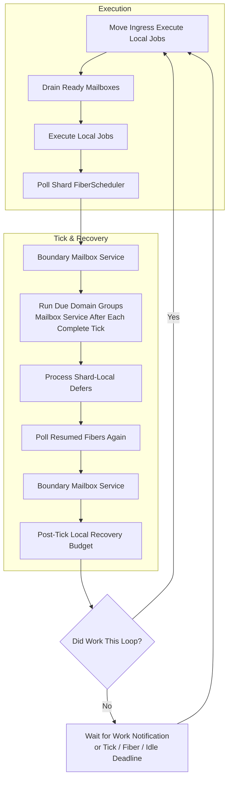

Global domain의 worker들이 shard-owned state를 직접 변경하도록 두면, owner를 정하고 route한 의미가 사라집니다. Jam에서 **owner-local serial execution**은 ownership 결정을 실제 상태 변경 규칙으로 만드는 경계이며, `ShardExecutor`가 담당합니다. 이후 문서에서는 이 실행 경계를 간단히 **shard**, 실행기를 **`ShardExecutor`** 라고 부릅니다.

shard는 일반적인 thread pool worker와 다릅니다. 하나의 job을 임의의 worker가 가져가는 대신, 배치된 세션·사용자·월드 상태와 그 상태를 변경하는 순서를 함께 소유합니다.

이 구조는 한 owner마다 thread나 lock을 두는 방식 대신, 여러 owner를 소수의 shard에 배치하고 shard 내부에서 직렬화하는 선택입니다. owner 간 병렬성은 유지하면서 thread 수와 synchronization 비용을 제한할 수 있지만, 한 shard의 긴 작업은 같은 shard의 다른 owner에도 영향을 줄 수 있으므로 실행 budget과 작업 분리가 중요합니다.

## Shard-Local State

각 shard의 `ShardLocal`에는 ECS registry와 세션, 사용자, 월드 상태가 저장됩니다. [[Projects/Jam/Execution Model/01. State Ownership & Task Routing|State Ownership & Task Routing]]에서 선택한 route에 따라 같은 owner의 job이 같은 shard로 전달되며, shard main thread가 이를 직렬로 실행합니다.

서로 다른 shard는 병렬로 실행되지만 한 shard 안의 authoritative mutation은 main thread로 수렴합니다. 이를 통해 hot path의 global lock을 줄이고, 상태 변경 순서를 실행 구조 자체로 보장합니다.

## Main Loop

`ShardExecutor`의 main loop는 한 종류의 queue만 비우지 않습니다. 다음 작업을 제한된 budget으로 번갈아 처리합니다.

- 외부에서 들어온 job을 local priority queue로 이동
- 우선순위에 따른 local job 실행
- ready mailbox 처리
- 예정된 domain system 실행
- shard-local deferred 작업 처리
- fiber scheduler polling

job 실행과 mailbox 이동·처리에 budget을 두고, domain tick은 catch-up 횟수를 제한합니다. 실행 중인 callback은 완료될 때까지 같은 shard thread를 사용합니다. 실행할 일이 없으면 다음 tick과 fiber wake-up 시간을 고려해 대기합니다.

현재 main loop의 큰 순서는 다음처럼 볼 수 있습니다.

두 번의 scheduler poll은 다른 thread에서 게시된 completion과 continuation을 같은 loop에서 반영할 기회를 줍니다. post-tick recovery pass는 tick/fiber 처리 이후 local job을 추가로 실행하며, ingress를 다시 이동시키지 않습니다.

`ServiceMailboxesAtBoundary()`는 첫 Poll 이후, 각 domain tick 완료 후, 두 번째 Poll 이후에 실행됩니다. mailbox에서 옮긴 job은 local priority queue에 합류하여 기존 job과 같은 우선순위 규칙으로 실행됩니다. 기본 boundary budget은 mailbox 8개, 이동 job 64개, mailbox당 8개, local 실행 64개와 200 μs입니다. 이동량은 해당 pass의 실행 budget 이하로 제한합니다. 시간 제한은 다음 처리 여부를 결정하는 기준이며 실행 중인 callback을 중단하지 않습니다.

domain callback이 반환된 뒤 mailbox를 처리하므로 한 world tick 내부의 input → physics → AOI → replication 순서는 유지됩니다. catch-up은 기본 최대 4회이며, 한도 이후에도 해당 domain이 밀려 있으면 다음 예정 시각을 현재 시각과 period 기준으로 조정합니다.

## Dispatch at the Execution Boundary

`ShardExecutor`가 설명하는 것은 **도착한 작업을 어디서 어떤 순서로 실행하는가**입니다. 작업이 producer thread에서 이 지점까지 안전하게 넘어오는 과정은 별도의 dispatch 계약입니다.

shard ingress는 shard 전체를 향한 작업을 받고, ready mailbox는 특정 owner를 향한 작업을 받습니다. 두 경우 모두 실제 callback은 shard main loop가 실행합니다. producer 측 전달, stale reference 검증, mailbox lifecycle은 [[Projects/Jam/Execution Model/04. Cross-Thread Task Dispatch|Cross-Thread Task Dispatch]]에서 이어서 설명합니다.

## Waiting Within the Execution Boundary

각 shard는 main thread에 연결된 `FiberScheduler`를 가집니다. 이는 shard와 별개의 실행 경계가 아닙니다. shard에서 시작한 흐름이 외부 완료를 기다릴 때 owner-local continuation을 보존하고, 같은 shard로 돌아와 이어서 실행하기 위한 장치입니다.

shard 내부 코드는 fiber를 생성한 뒤 await key로 suspend하고, 완료를 받은 실행 경로가 `ResumeFiber()`를 호출할 수 있습니다. fiber가 기다리는 동안 shard main loop는 다른 job과 system을 처리합니다.

fiber의 내부 scheduling과 global scheduler와의 차이는 [[Projects/Jam/Execution Model/05. Fiber-Based Async Scheduling|Fiber-Based Async Scheduling]]에서 다룹니다.

## Shard Thread and Domain Ticks

각 shard는 하나의 실행 thread에서 job, mailbox callback, domain tick과 fiber continuation을 처리합니다. world simulation은 등록된 domain callback에서 직접 실행하며 physics도 같은 thread에서 동기적으로 완료합니다.

같은 shard의 여러 world는 이 thread의 실행 시간을 공유합니다. 긴 tick은 해당 shard의 다른 job과 mailbox 처리를 지연시키므로 phase별 비용과 mailbox 대기 시간을 함께 관찰해야 합니다. 여러 shard는 각자의 thread에서 병렬로 진행합니다.

thread 수와 선택적인 CPU affinity 설정은 [[Projects/Jam/Execution Model/06. Thread and Core Topology|Thread and Core Topology]]에서 설명합니다. 상태가 특정 shard에 귀속되는 것과 그 thread가 특정 CPU에 고정되는 것은 별개의 계약입니다.

## Execution Boundary Constraints

shard ownership은 상태 변경을 단순하게 만들지만, 다른 shard의 결과가 필요하면 동기 함수 호출처럼 즉시 반환할 수 없습니다. 요청을 대상 shard로 보내고 completion을 받아야 합니다. Jam은 이 비용을 숨기기보다 dispatch와 async scheduling 계약으로 드러냅니다.

## Implementation References

- [`ShardExecutor.h`](https://github.com/akxotjr/Jam/blob/master/JamNet/include/jamnet/core/executor/ShardExecutor.h) — loop와 boundary budgets, domain groups, mailbox/fiber integration
- [`ShardExecutor.cpp`](https://github.com/akxotjr/Jam/blob/master/JamNet/src/core/executor/ShardExecutor.cpp) — main loop, tick 경계 mailbox service와 idle wait
- [`ShardDomain.h`](https://github.com/akxotjr/Jam/blob/master/JamNet/include/jamnet/core/executor/ShardDomain.h) — shard domain identifiers
