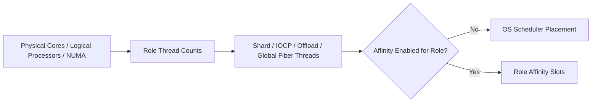

앞선 문서의 ownership과 execution domain은 논리적인 구조지만, 실제 latency와 처리량은 thread 수와 OS의 CPU 배치에도 영향을 받습니다. 각 shard는 하나의 실행 thread를 사용하며, 같은 shard의 job과 world tick은 이 thread의 실행 시간을 공유합니다.

Jam은 executor 역할의 수와 CPU 배치를 runtime 설정으로 결정합니다. 목표는 모든 thread를 무조건 고정하는 것이 아니라, server·client·다중 client처럼 서로 다른 실행 환경에서 예측 가능한 기본 배치를 제공하는 것입니다. 논리적 실행 모델과 hardware policy를 분리해 ownership 규칙을 바꾸지 않고도 배치를 조정할 수 있게 했습니다.

## Core Layout

`CoreLayout`은 실행 역할별 thread 수를 정의합니다.

| Role | 설명 |
| --- | --- |
| `shards` | owner-local 상태와 system을 실행하는 shard main threads |
| `iocp` | 네트워크 I/O completion workers |
| `fiber` | global fiber worker; 현재 1개로 고정 |
| `offload` | owner가 없는 일반 job workers |

layout은 직접 지정하거나 hardware 정보와 `AutoCoreLayoutConfig`로 계산할 수 있습니다. 자동 계산은 물리 core budget에서 예약 thread를 제외한 뒤 `IO_Heavy`, `CPU_Heavy`, `Balance` mode에 따라 offload 비중을 정하고 나머지를 shard에 할당합니다.

## Usage Profiles

- `CoreProfileServer`는 기본 usage scale 1로 runtime thread budget을 계산합니다.
- `CoreProfileClient`는 기본 usage scale을 2/3로 두어 OS와 rendering을 위한 여유를 남깁니다.
- `CoreProfileMultipleClient`는 여러 client가 공유하는 실행 환경을 대상으로 하며 기본 usage scale은 1입니다. 필요한 thread budget은 `usageScale`과 `reservedThreads`로 조정할 수 있습니다.

프로필은 시작점일 뿐이며 실제 workload에 따라 thread 수와 affinity를 조정할 수 있습니다.

## Physical Cores and SMT Siblings

Windows topology 조회는 physical core마다 primary logical processor와 가능한 SMT sibling 정보를 `CoreSlot`으로 구성합니다. 이 정보는 physical core 수 계산과 선택적인 affinity slot 구성에 사용합니다.

각 shard의 job과 domain tick은 하나의 shard thread에서 실행합니다. 기본 profile은 shard의 CPU 배치를 OS scheduler에 맡깁니다. 여러 shard는 병렬로 실행되며, 동일 shard에 속한 상태의 변경 순서는 thread가 실행되는 CPU와 무관하게 유지됩니다.

shard 내부 동작은 [[03. Owner-Local Serial Execution|Owner-Local Serial Execution]]에서 설명합니다.

## NUMA Placement

`QueryNumaNodesWithPrimaryCoreSlots()`는 NUMA node별 physical core slot을 조회하고, `BuildRoundRobinCoreSlots()`는 node 사이에 affinity slot을 분산합니다. shard 수가 여러 NUMA node를 활용할 수 있을 만큼 충분하면 자동 layout도 shard 수를 node 수에 맞추려 시도합니다.

NUMA 정보는 layout 계산과 affinity 계획에 사용합니다. affinity가 비활성화된 역할의 실제 배치는 OS가 결정합니다. NUMA-aware allocation helper도 제공하지만 모든 runtime 데이터가 자동으로 node-local memory에 배치되는 것은 아니므로, thread 배치와 memory locality는 함께 확인해야 합니다.

## Affinity Policy

`ExecutorAffinityConfig`는 shard, IOCP, offload, fiber, main thread를 역할별로 고정할지 선택합니다. affinity를 사용하면 실행 위치와 성능 변동을 예측하기 쉬워지지만, 다른 process와 core를 공유하는 환경에서는 오히려 scheduler의 선택을 제한할 수 있습니다.

`useProfileDefaults = true`이면 `GlobalExecutor` 초기화 시 `DefaultExecutorAffinityConfig()`가 아래 기본값을 적용합니다.

| Role | Server | Client | MultipleClient |
| --- | --- | --- | --- |
| Shard | OS 배치 | OS 배치 | OS 배치 |
| IOCP | OS 배치 | OS 배치 | OS 배치 |
| Main thread | OS 배치 | OS 배치 | OS 배치 |
| Offload workers | 고정 | OS 배치 | OS 배치 |
| Global fiber worker | 고정 | OS 배치 | OS 배치 |

명시적인 affinity 구성을 사용하려면 `useProfileDefaults = false`로 두고 역할별 flag를 지정합니다. `ExecutorAffinityConfig` 구조체 자체의 `pinShardWorkers` 초기값은 `true`이므로, 수동 구성에서는 원하는 shard 정책을 함께 지정해야 합니다. 이 flag는 shard 실행 thread의 pinning을 제어합니다.

## Implementation References

- [`CoreTopology.h`](https://github.com/akxotjr/Jam/blob/master/JamNet/include/jamnet/core/executor/CoreTopology.h) — core layout, affinity configuration, usage profiles
- [`NumaTopology.h`](https://github.com/akxotjr/Jam/blob/master/JamNet/include/jamnet/core/executor/NumaTopology.h) — NUMA/core-slot discovery
- [`ShardExecutor.cpp`](https://github.com/akxotjr/Jam/blob/master/JamNet/src/core/executor/ShardExecutor.cpp) — shard 실행 thread와 선택적인 pinning
- [`GlobalExecutor.h`](https://github.com/akxotjr/Jam/blob/master/JamNet/include/jamnet/core/executor/GlobalExecutor.h) — global affinity plan and role-specific workers
