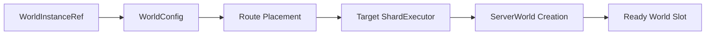
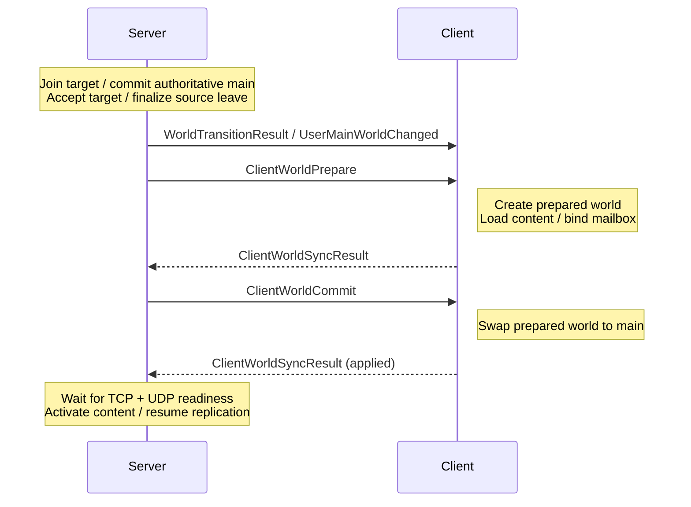
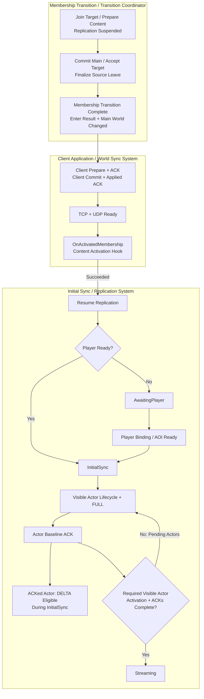

## Transactional World Transition

world 진입은 user의 `mainWorld` pointer를 바꾸는 한 번의 연산이 아닙니다. destination을 찾고, source membership을 분리하고, target membership과 content를 준비한 뒤 authoritative main world를 확정해야 합니다. 이어서 client가 같은 world를 준비하고 적용한 것을 확인해야 Player 생성과 replication을 활성화할 수 있습니다.

Jam은 world 변경을 여러 owner를 통과하는 명시적인 state machine으로 만듭니다.

```mermaid
flowchart LR

Resolve["Resolve Target"] --> 
Detach["Detach Source"] --> 
Join["Join Target Membership /<br/>Prepare Content"] --> 
Commit["Commit Authoritative<br/>Main World"] --> 
Accept["Accept Target /<br/>Finalize Source Leave"] --> 
Done["Complete Membership Transition"] --> 
ClientPrepare["Client Prepare + ACK"] --> 
ClientCommit["Client Commit"] --> 
Applied["Client Applied ACK /<br/>TCP + UDP Ready"] --> 
Activate["Activate Content /<br/>Resume Replication"]
```

분산 transaction framework를 추가하는 대신, 실제 world 전환에 필요한 단계와 보상 동작을 도메인 state machine으로 드러낸 선택입니다.

## Destination and World Creation

enter request는 default archetype instance, explicit instance 또는 authored destination을 선택할 수 있습니다. coordinator는 `WorldInstanceDatabase`에서 destination을 해석하고 `WorldConfigResolver`로 template, actor level과 physics asset을 결합합니다.

world가 아직 없으면 instance ID에서 route를 만들고 shard에 배치한 뒤 비동기로 생성합니다. 같은 instance를 동시에 요청한 caller들은 하나의 creation slot에서 결과를 기다립니다.

instance identity와 world creation을 coordinator가 중재하는 이유는 요청마다 중복 world를 만들지 않고, 아직 creating인 world와 ready world를 명확히 구분하기 위해서입니다. 대신 coordinator는 cross-shard continuation과 world slot lifecycle을 관리해야 합니다.

## Revision and Transition Token

user의 main world state에는 revision이 붙습니다. client request가 보낸 `expectedMainRevision`이 현재 revision과 다르면 오래된 UI action이나 재전송된 command로 보고 거부합니다.

`WorldTransitionToken`은 진행 중인 server transition을, `WorldSyncToken`은 client prepare/commit 응답을 식별합니다. 비동기 completion은 user ID만으로 적용하지 않고 token과 예상 phase가 일치하는지 다시 확인합니다.

이 검사는 timeout이나 reconnect 이후 늦게 도착한 completion이 새 transition을 진행시키는 것을 막습니다.

## Prepare and Commit

`ServerWorldTransitionCoordinator`는 source membership detach, target의 `JoinMembership()`, authoritative main commit, target entry 확정과 source leave 정리를 수행합니다. 이때 target은 replication을 `Suspended`로 유지합니다. `OnJoiningMembership()`과 `OnPreparedMembership()`은 상위 content 계층이 입장 조건을 검증하고 world별 상태를 준비할 수 있는 확장점입니다.

`CompleteEnter()`는 transition result와 `USER_MAIN_WORLD_CHANGED`를 TCP로 보내고 membership 전환을 완료합니다. 이어서 `ServerWorldSyncSystem::BeginWorldSync()`가 별도의 token으로 client 동기화를 시작합니다.

client는 prepared world를 별도로 보관하고 token, world identity와 revision이 맞을 때만 main world로 승격합니다. prepare와 commit은 client 적용을 확인하는 두 단계이며, server membership transaction이 완료된 뒤 진행됩니다. 서버는 commit 적용 응답과 양쪽 transport의 준비를 확인한 후 world owner에게 `ActivateMemberReplication()`을 요청합니다.

## Cross-World Execution

user state, source world와 target world는 서로 다른 shard에 있을 수 있습니다. coordinator는 각 owner로 command를 dispatch하고 결과를 다시 user shard의 transition state로 모읍니다.

source에서는 `DetachMembership()`으로 복구에 필요한 상태를 보관하고 membership을 분리합니다. target에서는 `JoinMembership()`이 `OnJoiningMembership()` 검증, member 등록, `OnPreparedMembership()`을 수행합니다. authoritative `UserWorldState`는 user shard에서 revision과 함께 commit되며, target의 `CompleteMembershipEntry()`와 source의 `CompleteMembershipLeave()`가 전환을 마무리합니다.

client 동기화 완료 후의 content activation도 world owner에서 실행합니다. `ServerWorldSyncSystem`은 user shard에서 요청을 추적하고, world shard의 `ActivateMemberReplication()` 결과를 다시 user shard로 받아 처리합니다.

동기 호출처럼 보이게 global lock을 잡지 않고 owner별 command로 분리했기 때문에 shard independence를 유지할 수 있습니다. 그 대가로 각 completion에 token·phase 검증과 timeout이 필요합니다.

## Failure and Rollback

실패 위치에 따라 보상 경로가 달라집니다.

- source detach 전에 실패하면 현재 membership을 유지합니다.
- target join을 되돌려야 하면 `CancelMembership()`과 content의 `OnRollbackMembership()`으로 준비 상태와 membership을 정리합니다.
- source가 이미 detach되었다면 `RecoverMembership()`과 `OnRestoredMembership()`으로 source membership과 Player binding을 복구합니다.
- authoritative main world가 잠시 target으로 바뀌었다면 source로 되돌리고 revision을 갱신합니다.
- 전환 중 disconnect나 timeout은 진행 중인 world command의 결과와 token을 확인하며 취소·복구합니다. 정리 작업이 실패하면 재시도합니다.

membership 전환 완료 후 client prepare/apply 또는 content activation이 실패하는 경우는 별도 world sync 경로에서 처리합니다. activation 실패는 deadline 안에서 재시도하며, world sync 실패·timeout은 TCP disconnect를 요청하고 세션 정리 경로로 넘깁니다. 이 단계는 완료된 membership 전환을 source로 자동 rollback하는 계약이 아닙니다.

rollback도 실패할 수 있으므로 state machine은 terminal failure와 in-flight command를 구분합니다. 이 복잡성은 부분 성공을 숨기지 않고 명시적으로 복구하기 위해 지불한 비용입니다.

## Transition Completion and Initial Sync

membership 전환 완료, client world 적용, replication streaming 준비는 서로 다른 완료 조건입니다. target membership이 등록될 때 replication은 `Suspended`이며, 상위 content 계층은 membership hook에서 입장에 필요한 상태를 준비합니다. membership 전환 완료 자체는 client world 적용이나 visible actor의 baseline ACK를 기다리지 않습니다.

client commit 적용 확인과 transport 준비가 끝나면 `ActivateMemberReplication()`이 pending content의 `OnActivatedMembership()`을 호출합니다. 상위 content 계층은 이 확장점에서 Player 생성 등 client world 적용 이후 필요한 처리를 수행하고 성공 여부를 반환합니다. activation에 성공하면 `ResumeMemberReplication()`이 `ResumeUserWithFullSync()`를 호출하여 기존 introduction/baseline delivery 상태를 정리하고, Player가 있으면 `InitialSync`, 없으면 `AwaitingPlayer`로 전환합니다. 후자의 경우 Player binding 시 `BeginInitialSync()`로 진입합니다.

`InitialSync`에서는 visible actor의 lifecycle/FULL과 baseline ACK를 처리하며, 필요한 ACK가 모두 확인되면 `Streaming`으로 전환합니다. actor별 ACK가 확인되면 `InitialSync` 중에도 해당 actor의 DELTA 전송이 가능하므로, user phase 전체와 actor별 decode 준비 조건을 구분해야 합니다.

도표의 세 영역은 서로 다른 완료 조건과 담당 시스템을 나타냅니다. content activation 이후에는 Player 준비 여부에 따라 initial sync 진입 시점이 달라집니다. 마지막 영역에서는 actor별 ACK와 DELTA 허용이 진행되는 동안 다른 actor의 FULL/ACK를 계속 처리합니다. 재전송은 설정된 간격에 따르며, `LocalDrivenKine`은 baseline ACK 대기 대상에서 제외합니다. activation 재시도·world sync timeout은 앞의 실패 처리 계약을 따릅니다.

따라서 enter 성공 응답만으로 Player가 이미 존재하거나 replication streaming이 준비되었다고 가정해서는 안 됩니다. 상위 application은 현재 world의 controlled actor와 필요한 frontend 상태가 준비되었는지 별도로 확인해야 합니다.

actor와 control이 준비되는 과정은 [[Projects/Jam/Game World/02. Actor Lifecycle and Control|Actor Lifecycle and Control]]에서, initial visibility는 [[Projects/Jam/Game World/04. Area of Interest Management|Area of Interest Management]]에서, baseline과 initial sync 완료 조건은 [[Projects/Jam/State Synchronization/03. Baseline and Delta State|Baseline and Delta State]]에서 이어집니다.

## Implementation References

- [Transition command 처리와 완료 조정](https://github.com/akxotjr/Jam/blob/master/JamNet/src/runtime/world/lifecycle/ServerWorldTransitionCoordinator.cpp)
- [Server world transition 계약](https://github.com/akxotjr/Jam/blob/master/JamNet/include/jamnet/runtime/world/lifecycle/ServerWorldTransitionCoordinator.h)
- [World transition 상태와 command 타입](https://github.com/akxotjr/Jam/blob/master/JamNet/include/jamnet/runtime/world/lifecycle/WorldTransitionTypes.h)
- [Client main-world transition 상태](https://github.com/akxotjr/Jam/blob/master/JamNet/include/jamnet/runtime/world/lifecycle/ClientMainWorldState.h)
- [World shard lifecycle 상태 관리](https://github.com/akxotjr/Jam/blob/master/JamNet/src/runtime/world/lifecycle/WorldShardState.cpp)
