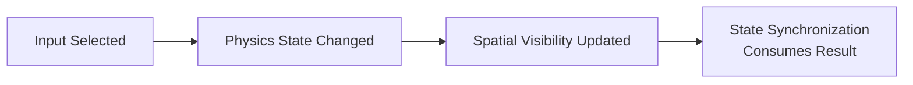
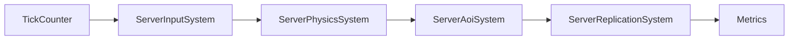
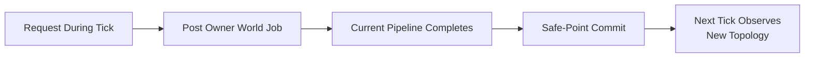

## Tick Ordering Contract

input, physics, AOI와 replication을 서로 독립적인 periodic job으로만 실행하면 각 subsystem의 평균 처리량은 높일 수 있지만 한 tick의 인과관계가 흐려집니다. replication이 이전 physics 결과를 읽거나 AOI가 이동 전 위치를 기준으로 visibility를 계산할 수 있기 때문입니다.

Jam은 `ServerWorld` 안에서 authoritative pipeline의 순서를 고정합니다.

이 순서는 단순 호출 순서가 아니라 **어떤 authoritative 결과를 다음 단계가 읽을 수 있는가**를 정의하는 world-level contract입니다.

## Server World Pipeline

현재 `ServerWorld`는 world registry에 `ServerInputSystem`, `ServerPhysicsSystem`, `ServerAoiSystem`, `ServerReplicationSystem`을 구성하고 fixed-step pipeline으로 실행합니다.

### Input

user별 input queue에서 이번 tick에 적용할 command를 선택합니다. simulation은 fixed tick을 유지하며, 실제로 적용한 input sequence는 이후 state synchronization에서 `inputAck`로 client에 돌려줄 수 있습니다.

### Physics

선택된 input을 controlled actor에 적용한 뒤 `PhysicsFacade::Simulate()`를 동기적으로 호출합니다. PhysX CPU task는 같은 shard thread에서 inline 실행됩니다. physics 결과와 실제 적용된 input sequence를 반영한 뒤 active entity 목록을 AOI와 replication에 전달합니다.

### AOI

이번 physics 결과의 위치를 기준으로 user별 spatial visibility를 갱신합니다. 여기서 만들어지는 `entered / remained / left` membership은 다음 state synchronization 단계가 사용할 입력입니다.

### State Synchronization Handoff

`ServerReplicationSystem`은 world pipeline 안에서 실행되지만 책임은 Game World와 분리해 봅니다. Game World는 authoritative state와 visibility를 만들고, State Synchronization은 이를 lifecycle/snapshot/baseline 전송 모델로 변환합니다.

자세한 과정은 [[Projects/Jam//State Synchronization/01. Replication Model|Replication Model]]에서 설명합니다.

## World-Local Pipeline and Shard Execution

각 world는 owner shard에 등록된 domain callback에서 pipeline 전체를 직접 실행합니다. input부터 replication과 metric 기록까지 같은 callback 안에서 순서대로 완료합니다.

`ShardExecutor`는 각 domain tick이 완료된 뒤 bounded mailbox service를 수행합니다. tick 사이에 도착한 제어 작업을 처리하면서 world 내부의 인과 순서를 유지하는 경계입니다. 긴 world tick은 반환될 때까지 같은 shard의 다른 작업을 지연시키므로 phase 비용을 함께 관찰해야 합니다.

## Fixed Step and Backlog

fixed tick은 simulation 시간 단위를 예측 가능하게 하지만 처리 시간이 tick interval을 넘으면 backlog가 생깁니다. 무제한 catch-up은 지연을 회복하려다 shard 점유 시간을 더 늘릴 수 있고, tick을 무조건 버리면 simulation continuity가 깨질 수 있습니다.

executor는 domain별 catch-up을 기본 최대 4회로 제한하고, 한도 이후에도 밀린 domain의 다음 예정 시각을 현재 시각과 period 기준으로 조정합니다. world/executor metrics로 input, physics, AOI와 replication의 비용 및 mailbox 대기를 함께 관찰합니다. `finalize_duration`은 metric layout 호환을 위해 유지하며 현재 world tick에서는 0으로 기록합니다.

## Safe Points and Deferred Mutation

pipeline 중간에 actor와 membership index를 변경하면 앞 phase와 뒤 phase가 서로 다른 world topology를 볼 수 있습니다. server의 actor spawn/despawn과 membership API는 owner shard의 tick 밖에서 호출하도록 검사합니다. tick 안에서 발생한 portal event는 world job을 게시해 전환 요청을 tick 종료 뒤 처리합니다.

호출자는 tick 밖에서 lifecycle 작업을 실행하도록 dispatch해야 합니다. lifecycle API는 owner shard에서 수행한 작업 결과로 completion을 반환하며, 현재 tick이 끝나기까지의 대기는 게시된 job의 실행 지연에 반영됩니다.

## Trade-offs

- 명시적인 phase 순서는 이해와 검증이 쉽지만 phase 간 병렬성은 제한됩니다.
- 동기 tick은 phase 순서와 lifetime을 단순하게 유지하지만 긴 tick은 같은 shard의 mailbox와 다른 domain을 지연시킵니다.
- fixed step은 prediction/replay와 잘 맞지만 overload 시 backlog 정책이 필요합니다.
- safe-point mutation은 consistency를 높이지만 lifecycle command latency가 한 pipeline boundary만큼 늘어날 수 있습니다.

## Implementation References

- [Authoritative tick pipeline 구현](https://github.com/akxotjr/Jam/blob/master/JamNet/src/runtime/world/simulation/server/ServerWorld.cpp)
- [Authoritative world ownership과 pipeline 계약](https://github.com/akxotjr/Jam/blob/master/JamNet/include/jamnet/runtime/world/simulation/server/ServerWorld.h)
- [Server input 소비 계약](https://github.com/akxotjr/Jam/blob/master/JamNet/include/jamnet/runtime/world/simulation/server/ServerInputSystem.h)
- [Authoritative physics phase](https://github.com/akxotjr/Jam/blob/master/JamNet/include/jamnet/runtime/world/simulation/server/ServerPhysicsSystem.h)
- [Server AOI 갱신 계약](https://github.com/akxotjr/Jam/blob/master/JamNet/include/jamnet/runtime/world/simulation/server/ServerAoiSystem.h)
- [Server replication 상태와 전송 계약](https://github.com/akxotjr/Jam/blob/master/JamNet/include/jamnet/runtime/world/simulation/server/ServerReplicationSystem.h)
