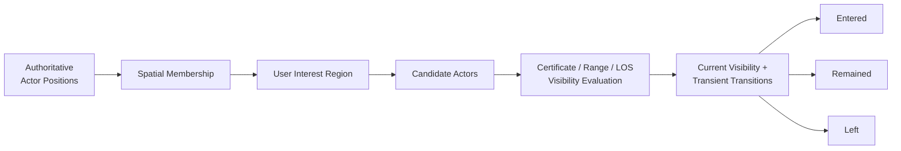
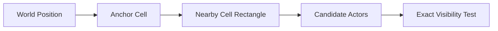
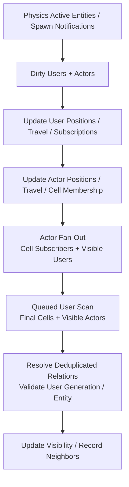
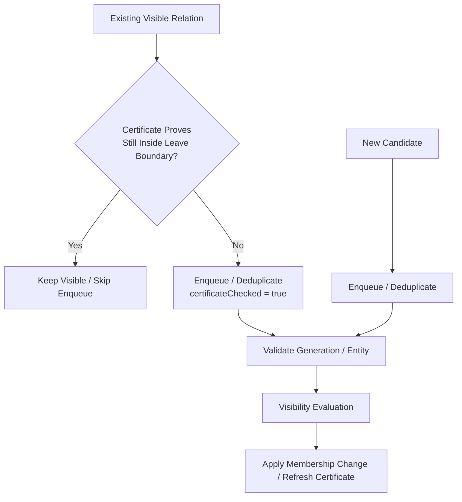
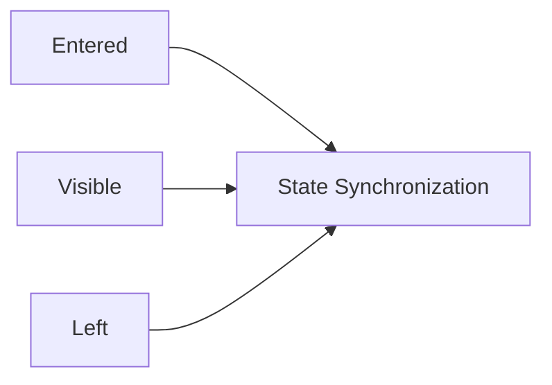

world의 모든 actor를 모든 user와 비교하면 actor 수와 user 수가 늘수록 visibility 비용이 빠르게 증가합니다. 더 중요한 점은 AOI가 단순 packet filter가 아니라 **현재 authoritative world에서 어떤 actor가 특정 user에게 의미 있는가**를 계산하는 spatial membership 문제라는 것입니다.

Jam은 AOI가 visibility membership을 결정하고, State Synchronization이 그 결과를 어떤 lifecycle/snapshot으로 전달할지 결정하도록 책임을 분리합니다.



## Spatial Grid

actor의 authoritative position을 XZ grid cell에 배치하고, user의 Player 위치를 기준으로 interest cell을 구독합니다. 각 cell은 actor 목록과 subscriber user 목록을 함께 보관합니다. user가 이동하면 구독 cell의 actor를, actor가 이동하면 해당 cell의 subscriber를 통해 후보를 찾습니다.

`AoiConfig`는 `AABB_2D`, `AABB_3D`, `Circle`, `Sphere`를 지원합니다. broad phase는 XZ cell을 사용하고, 최종 판정에서 shape에 따라 Y축까지 검사합니다. 기본 cell 크기는 30, AABB half extent와 radius는 30입니다. user anchor cell이 바뀌면 현재 위치에서 interest cell 목록을 다시 계산하고 구독 차이를 반영합니다.



actor의 cell slot index와 user의 cell별 subscriber index를 보관하여 제거 시 이동된 slot의 index를 함께 보정합니다. cell이 너무 작으면 membership update가 잦아지고, 너무 크면 candidate 수가 증가하므로 actor density와 interest 범위에 맞춘 tuning이 필요합니다.

## Hysteresis and Movement Tracking

경계 근처 actor가 작은 움직임마다 enter/leave를 반복하면 downstream lifecycle과 baseline churn이 증가합니다. 이미 visible한 actor에는 AABB half extent 또는 radius에 `hysteresisOffset`을 더한 leave boundary를 적용합니다. 기본 offset은 10이며 신규 진입은 원래 범위를 사용합니다.

이 선택은 정확한 기하 경계를 매 tick 강제하는 대신 membership stability를 얻습니다. 반대로 hysteresis가 지나치게 크면 실제 관심 범위 밖 actor를 오래 유지하므로 tuning 대상입니다.

같은 cell 안에서도 실제 위치가 달라지면 visibility가 바뀔 수 있습니다. user와 actor는 위치 변경 시 visibility 갱신을 예약하고 X/Z축별 절대 이동량을 `double` 누적값으로 기록합니다. 이 누적 이동량은 기존 visible 관계가 leave boundary 안에 남는지 증명하는 certificate의 입력입니다.

## Tick Update and Candidate Routing

AOI tick은 physics가 전달한 active entity 목록에서 dirty actor와 controlled user를 수집하고 다음 순서로 처리합니다.



user와 actor 양쪽의 위치·누적 이동량을 먼저 반영한 뒤 relation 후보를 만듭니다. 이동한 user는 `visibilityQueued`로 표시하고 최종 actor cell을 직접 순회하므로 actor fan-out에서 같은 user를 중복 처리하는 일을 줄입니다. 신규 후보는 cell index에서 찾고, 기존 visible 관계는 user의 visible set과 actor의 visible-user 역방향 index로 별도 추적합니다. 따라서 기존 대상이 interest cell 밖으로 이동한 경우에도 leave 판정을 수행할 수 있습니다.

평가 queue는 `(UserId, entt::entity)`로 중복을 제거하고 user subscription generation을 기록합니다. 처리 시 user·entity·`ActorId`의 유효성을 확인하며, generation이 달라진 요청은 적용하지 않고 user를 다시 dirty로 표시합니다.

Player binding의 `PreparePlayer()`는 pending actor cell 상태를 반영하고 해당 user의 초기 관심 cell을 직접 평가하여 AOI 준비를 완료합니다. 기존 user의 예약된 평가는 정상 AOI tick에 남깁니다. 이 준비 완료와 replication 송신 활성화는 별도 계약입니다.

## Visibility Certificate

기존 visible 관계에서 마지막 정밀 판정 당시의 축별 거리와 user·actor의 누적 이동량을 보관합니다. 이후 두 endpoint의 절대 이동량 증가분을 더하면 상대 거리가 늘어날 수 있는 상한을 얻습니다.

```text
movementBoundX = userTravelDeltaX + actorTravelDeltaX
movementBoundZ = userTravelDeltaZ + actorTravelDeltaZ

lastAbsDx + movementBoundX + 0.0001 <= aabbX + hysteresisOffset
lastAbsDz + movementBoundZ + 0.0001 <= aabbZ + hysteresisOffset
```

두 조건이 모두 성립하면 leave boundary 안에 남아 있으므로 기존 visibility를 유지할 수 있습니다. certificate는 유효한 기존 membership과 초기화된 endpoint 상태가 있고, `AABB_2D`이며 LOS가 비활성화된 경우에 적용합니다. 정밀 판정 결과가 visible이면 거리와 누적 이동량 기준을 갱신합니다. 절대 이동량은 보수적인 상한이므로 왕복 이동에서도 누적되며, certificate가 실패하면 현재 위치로 다시 정밀 판정합니다.



`EnqueueVisibleRelation()`은 certificate를 queue 등록 전에 검사합니다. 통과한 relation은 pending queue와 dedup set에 넣지 않으므로 평가 비용뿐 아니라 enqueue 비용도 줄입니다. 실패한 relation에는 `certificateChecked`를 기록하여 resolve 단계에서 같은 certificate 검사를 반복하지 않고 range·LOS 판정으로 진행합니다. 직접 평가 등 아직 precheck하지 않은 기존 visible 관계에는 `EvaluateVisibility()`의 certificate early-return 경로가 적용될 수 있습니다.

## Visibility Membership

AOI는 user별 visible membership과 이번 update의 entered/left 변화를 관리합니다. actor와 user의 spatial membership이 바뀌면 영향받는 후보만 다시 평가하고, actor destroy나 user leave 시 관련 membership을 정리합니다.

| 출력 | 계약 |
| --- | --- |
| `visible` | 현재 range·LOS 조건을 만족하는 entity set. client의 replica 보유 상태와 독립적 |
| `entered` | 이전 replication pass 완료부터 현재 pass까지 한 번이라도 invisible → visible이 된 entity의 중복 제거 set |
| `left` | 같은 구간의 visible → invisible 또는 visible actor 파괴를 `ActorId`로 보관하는 목록 |

`entered`는 leave 이후에도 해당 구간 동안 유지되므로 항상 `visible`의 부분집합인 것은 아닙니다. `left`는 재진입해도 유지되며 중복과 `entered`와의 겹침이 가능합니다. 전환 순서와 횟수 전체를 보존하는 event log로 사용하지 않습니다. replication은 최종 visibility와 client knowledge를 함께 보고 lifecycle을 결정하며, transient 목록은 전송 성공 여부와 무관하게 replication pass 뒤 비웁니다.

양방향 또는 보조 index를 유지하는 이유는 actor 하나가 사라졌을 때 모든 user를 전수 순회하지 않고 영향받는 membership을 찾기 위해서입니다. 그 대신 index lifetime과 stale entry 방지가 추가 책임이 됩니다.

`m_visibleMembership`은 user·actor 관계와 actor 역방향 slot index, certificate를 보관합니다. user 구독 해제와 actor 파괴 시 관련 cell·visibility·LOS index를 함께 정리합니다. 파괴 시 `left`는 entity 대신 `ActorId`를 보관하여 identity를 후속 replication 처리까지 전달합니다.

## Experimental Line of Sight

거리나 shape 조건만으로 부족한 world에서는 physics query를 visibility 조건에 추가할 수 있습니다. 하지만 모든 candidate를 매 tick raycast하면 query 비용이 크게 증가하므로 LOS는 기본 spatial broad phase를 대체하는 것이 아니라 선택적 정밀 조건으로 보는 편이 맞습니다.

현재 구현에는 `enableLos`, `losRetestTicks`와 user-actor별 LOS cache가 있으며, 평가 요청 시 이전에 visible했던 대상은 설정된 interval 동안 cached 판정을 재사용합니다. `losRetestTicks`는 cache 재사용 조건이며 정지한 모든 관계를 주기적으로 재평가하는 timer는 아닙니다. 이 경로는 아직 실제 부하와 gameplay 환경에서 충분히 검증되지 않은 **실험적 기능**입니다. 기본값도 비활성화되어 있으며, 정확도·query 비용·cache invalidation 동작을 검증하기 전에는 안정된 AOI 계약으로 간주하지 않습니다.

## State Synchronization Boundary

AOI의 출력은 packet이 아니라 visibility 변화입니다.



처음 소개하는 actor에 `Created`, 이미 알려진 actor의 재진입에 `AoiEntered`, 범위 이탈에 `AoiLeft`를 선택하고 FULL/DELTA를 구성하는 것은 State Synchronization의 책임입니다. authoritative actor 파괴는 별도의 lifecycle 통지로 연결됩니다. AOI는 client knowledge나 baseline ACK를 관리하지 않습니다.

이 경계를 분리하면 spatial policy를 바꾸더라도 lifecycle/baseline protocol을 다시 설계할 필요가 없습니다.

자세한 연결은 [[Projects/Jam/State Synchronization/02. Lifecycle and Snapshot Delivery|Lifecycle and Snapshot Delivery]]와 [[Projects/Jam/State Synchronization/03. Baseline and Delta State|Baseline and Delta State]]에서 설명합니다.

## Trade-offs

- grid는 candidate 수를 줄이지만 cell membership 유지 비용이 생깁니다.
- hysteresis는 churn을 줄이지만 관심 범위 밖 actor를 잠시 유지할 수 있습니다.
- richer visibility condition은 정확도를 높이지만 per-candidate 비용이 증가합니다.
- visibility index를 유지하면 destroy/leave 처리는 빨라지지만 memory와 lifecycle complexity가 늘어납니다.
- certificate는 기존 관계의 enqueue·정밀 평가를 줄이는 대신 관계별 거리·이동량 상태를 추가합니다. 이동 상한이 leave boundary를 넘으면 정밀 판정으로 돌아갑니다.

## Observability

`aoi_duration`과 함께 `aoi_world`의 enqueue·certificate counter를 보면 최적화가 어느 단계의 작업을 줄였는지 확인할 수 있습니다.

| Metric | 해석 |
| --- | --- |
| `enqueue_attempts` | `EnqueueVisibilityEval()` 호출 수; dedup 검사 전 증가 |
| `unique_relations` | dedup 통과 후 pending queue에 추가한 relation 수 |
| `certificate_prechecks` | 기존 visible relation의 enqueue 전 certificate 검사 시도 수 |
| `certificate_precheck_hits` | precheck 통과로 enqueue를 생략한 수 |
| `certificate_early_returns` | `EvaluateVisibility()` 안의 certificate 검사 통과 수 |

`certificate_precheck_hits / certificate_prechecks`는 기존 visible relation의 precheck 성공 비율입니다. `unique_relations / enqueue_attempts`는 enqueue 시도 중 queue에 추가된 비율이며, 그 차이가 중복 제거된 시도입니다. precheck hit는 enqueue counter에 들어가지 않으므로 두 비율의 분모가 다릅니다. `unique_relations`를 정밀 range/LOS 검사 횟수로 해석해서도 안 됩니다. 상세 key와 집계 규칙은 [[Projects/Jam/Observability/03. Metric Catalog|Metric Catalog]]를 참조합니다.

before/after 비교에서는 같은 CCU뿐 아니라 world별 participant, `neighbors_per_user`, enter/leave churn과 replication workload를 함께 확인해야 합니다. 해당 버전에 metric이 없으면 0으로 대체하지 않고 미계측으로 표시합니다. 이 문서는 현재 알고리즘과 계측 계약을 설명하며 성능 개선율은 별도 측정 결과로 판단합니다.
## Implementation References

- [Server AOI 갱신 계약](https://github.com/akxotjr/Jam/blob/master/JamNet/include/jamnet/runtime/world/simulation/server/ServerAoiSystem.h)
- [AOI visibility 계산과 변경 적용](https://github.com/akxotjr/Jam/blob/master/JamNet/src/runtime/world/simulation/server/ServerAoiSystem.cpp)
- [World pipeline의 AOI phase 통합](https://github.com/akxotjr/Jam/blob/master/JamNet/src/runtime/world/simulation/server/ServerWorld.cpp)
