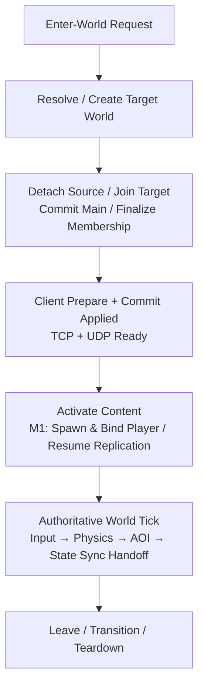

## Core Idea

Jam의 Game World는 **사용자 membership, actor lifetime, authoritative simulation, spatial visibility를 하나의 owner-local world runtime 안에서 유지하는 경계**입니다.

world를 단순한 ECS registry로만 보면 중요한 문제가 빠집니다. 사용자가 world를 이동할 때 source와 target 중 어느 쪽이 authoritative한지, actor identity가 ECS slot 재사용과 분리되어 있는지, input과 physics 결과가 어느 순서로 visibility에 반영되는지까지 함께 정의해야 합니다.

Jam은 이 문제를 다음 원칙으로 연결합니다.

> World membership은 transaction으로 관리하고, Actor의 수명은 명시적으로 정의하며, 서버 권위의 simulation은 정해진 인과 순서에 따라 진행합니다.

- world 진입과 이동은 prepare/commit/rollback 가능한 transition으로 처리합니다.
- world와 actor state는 배치된 shard의 world runtime이 소유합니다.
- `ActorId`와 `entt::entity`를 분리해 외부 identity와 내부 storage lifetime을 분리합니다.
- server tick은 input → physics → AOI → synchronization handoff 순서를 유지합니다.
- AOI는 user별 visibility membership을 계산하지만 packet format이나 baseline policy는 소유하지 않습니다.

## User, Member, Membership and Player

world 전환에서는 사용자 identity, world 소속 관계와 조작 actor의 수명을 구분합니다. 아래 용어는 현재 `UserContext`, `WorldMembershipHost`, `ServerWorld`의 계약을 기준으로 합니다.

| 용어 | 의미와 코드상 표현 | 소유 범위와 계약 |
| --- | --- | --- |
| **User** | TCP/UDP session을 연결하는 클라이언트 identity. `UserContext`가 account, transport session, main world revision과 전환·동기화 상태를 보관합니다. | user shard가 소유합니다. session 교체 자체가 User 교체를 의미하지 않으며, User의 committed world membership은 최대 하나입니다. |
| **Member** | 특정 World에서 바라본 User. `WorldUserContext`로 그 User의 revision과 session 정보를 보관합니다. | world owner가 관리하는 local view입니다. 별도 사용자 identity를 만들지 않으며, Player가 없는 Member도 존재할 수 있습니다. |
| **Membership** | User와 World의 소속 관계. local attach/detach와 전환의 commit·cancel·recover로 관리합니다. | `AddMember()` / `RemoveMember()`는 local attachment를 관리하고, transition coordinator는 User의 authoritative main world를 확정합니다. 전환 중의 준비·복구 상태와 committed membership을 구분합니다. |
| **Player** | User가 해당 World에서 조작하는 하나의 Actor. `ServerWorld`의 user-to-player binding으로 연결합니다. | Member당 0개 또는 1개입니다. physics·control·AOI 준비를 포함한 actor 수명을 world owner가 관리합니다. 전환 rollback을 위해 보관한 source Actor는 두 번째 committed Player로 세지 않습니다. |

Member 등록, membership 전환 완료, Player 생성과 replication 준비는 각각 별도의 상태입니다. M1은 membership 전환을 먼저 완료하고, client world 적용과 transport 준비 뒤 content activation에서 Player를 생성합니다. Player 생성 완료 시 AOI는 준비되지만, `Suspended` replication의 송신은 명시적인 resume 이후 시작합니다. baseline ACK를 통한 초기 동기화 완료는 replication이 별도로 판단합니다.

## End-to-End World Flow

State synchronization은 이 world runtime이 만든 authoritative state와 visibility 변화를 받아 lifecycle, snapshot, baseline, prediction/reconciliation 흐름으로 연결합니다. 자세한 내용은 [[../State Synchronization/index|State Synchronization]]에서 설명합니다.

## Responsibility Map

| 경계 | 책임 | 보호하는 것 |
| --- | --- | --- |
| Transition coordinator | source/target membership 전환과 authoritative main commit | 부분 진입, stale completion, rollback |
| World sync system | client prepare/commit 적용 확인과 transport 준비 후 activation | stale sync response, activation 재시도와 timeout |
| World owner shard | membership, ECS, actor와 world pipeline | mutation ordering과 lifetime |
| Actor identity | `ActorId`와 ECS entity 연결 | stale reference와 slot reuse |
| Simulation pipeline | input/physics/AOI 실행 순서 | tick 내부 인과관계 |
| AOI | user별 visibility membership | 불필요한 state-sync 범위 |

AOI가 packet 형식이나 baseline을 결정하지 않고, state synchronization이 actor lifetime 자체를 소유하지 않는 것이 중요한 경계입니다.

## Document Map

1. [[Projects/Jam/Game World/01. World Entry and Transition|World Entry and Transition]] — world membership을 prepare, commit, rollback하는 과정
2. [[Projects/Jam/Game World/02. Actor Lifecycle and Control|Actor Lifecycle and Control]] — stable actor identity와 ownership/control 분리
3. [[Projects/Jam/Game World/03. Authoritative Simulation|Authoritative Simulation]] — server world tick의 인과 순서와 safe point
4. [[Projects/Jam/Game World/04. Area of Interest Management|Area of Interest Management]] — cell subscription, dirty relation 갱신, visibility certificate와 출력·계측 계약

## Implementation References

- [World entry와 transition 조정](https://github.com/akxotjr/Jam/blob/master/JamNet/src/runtime/world/lifecycle/ServerWorldTransitionCoordinator.cpp)
- [World transition 상태와 command 타입](https://github.com/akxotjr/Jam/blob/master/JamNet/include/jamnet/runtime/world/lifecycle/WorldTransitionTypes.h)
- [Authoritative simulation 중심점](https://github.com/akxotjr/Jam/blob/master/JamNet/src/runtime/world/simulation/server/ServerWorld.cpp)
- [Actor registry와 lifecycle API](https://github.com/akxotjr/Jam/blob/master/JamNet/include/jamnet/runtime/world/actor/ActorDirectory.h)
- [Actor identity와 generation 모델](https://github.com/akxotjr/Jam/blob/master/JamNet/include/jamnet/runtime/world/actor/ActorId.h)
