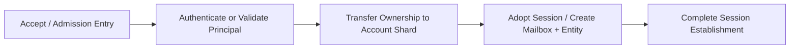
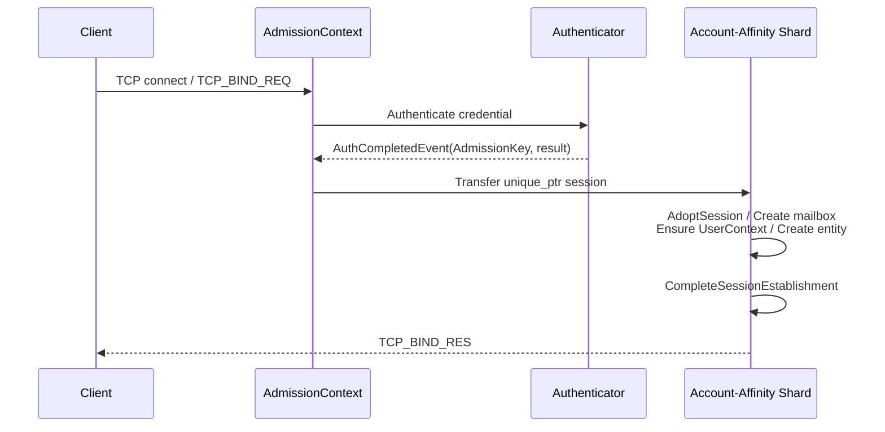
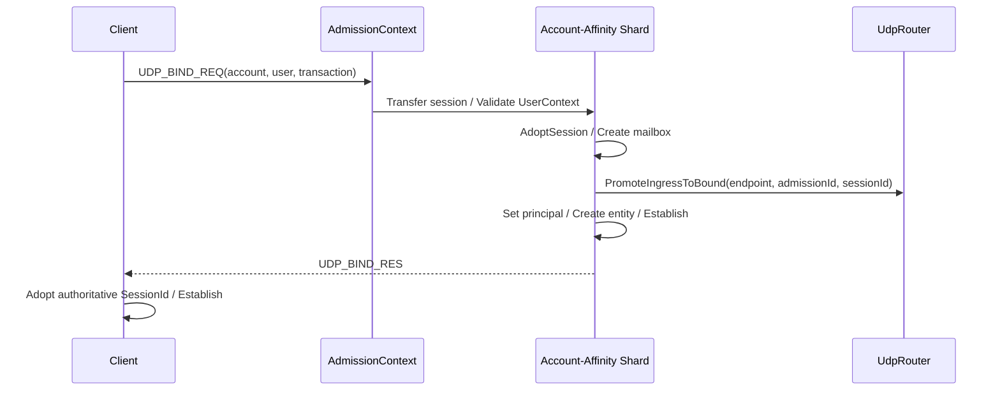

## Session and Socket Separation

Jam은 transport endpoint와 logical session을 분리합니다. Socket이 연결되었다는 사실만으로는 principal, owner shard, TCP/UDP association을 신뢰할 수 없기 때문입니다.

### Identity Vocabulary

**Principal은 인증된 사용자 identity를 의미하며, `SessionId`는 그 principal에 연결된 개별 transport session의 runtime identity입니다.** 현재 코드에서 principal은 다음 식별자의 관계로 표현됩니다.

| 용어 | 코드 타입 | 의미 |
| --- | --- | --- |
| Account identity | `AccountId` | 인증을 통해 확인하는 지속적인 사용자 식별자 |
| User runtime identity | `UserId` (`RuntimeId`) | `UserContext`를 owner shard에서 찾기 위한 실행 중 사용자 식별자 |
| Transport session identity | `SessionId` | 한 TCP 또는 UDP session을 owner shard에서 찾기 위한 실행 중 식별자 |

하나의 principal은 하나의 `UserContext`에 연결되고, 그 context는 TCP와 UDP `SessionId`를 각각 보관할 수 있습니다. 따라서 `UserId`와 `SessionId`는 같은 사용자를 가리키는 동의어가 아니며, UDP endpoint 역시 principal identity가 아닙니다.

### Lifecycle Model



## Session Ownership Establishment

### Lifecycle States and Ownership

서버는 인증·bind 전 session을 `AdmissionContext`의 entry로 보관하고, principal을 검증한 뒤 account affinity shard로 소유권을 넘깁니다. `AdmissionKey`는 `admissionId`, protocol과 endpoint ID로 admission 시도를 식별합니다.

| Phase | 소유·처리 경계 | 식별 및 상태 |
| --- | --- | --- |
| Admission active | `AdmissionContext`의 `AdmissionEntry`가 `unique_ptr<Session>` 소유 | TCP는 bind 대기·인증·인증 재시도, UDP는 bind 요청 검증 |
| Promoting | admission table에서 소유권을 꺼내 target shard job으로 전달 | principal의 account affinity route 선택 |
| Established | owner shard의 `SessionShardState::sessionsById`가 소유 | `SessionId`, mailbox와 ECS entity 구성 |
| Closing | admission 또는 established session의 현재 소유 경계에서 정리 | key·expected object·closing 상태를 확인하고 release |

`AdmissionContext`는 인증 결과와 retry·timeout·release event를 처리합니다. 인증 worker는 session을 소유하거나 직접 변경하지 않고 `AdmissionKey`가 붙은 결과 event를 돌려보냅니다. handler는 entry의 존재, phase와 TCP 인증 상태를 확인합니다. 인증된 session의 steady-state protocol state는 owner shard에 있습니다.

### Bootstrap, Promotion, and SessionId Issuance

TCP가 principal bootstrap의 기준선입니다.



`PromoteTcpToShard()`가 principal로 account affinity route를 선택하고 session 소유권을 shard job에 전달합니다. target shard의 `AdoptSession()`이 session을 등록하고 authoritative `SessionId`를 할당합니다. 이어 mailbox, `UserContext`, principal 정보와 entity를 구성하여 establishment를 완료하고 응답을 보냅니다. 승격 도중 closing 상태가 확인되면 release 경로로 넘깁니다.

Client는 bind 응답의 account/user 정보를 반영하고 `AdoptAuthoritativeSessionId()`로 server가 발급한 ID를 채택하여 local mailbox와 entity를 만듭니다. TCP와 UDP는 각각 별도의 authoritative `SessionId`를 사용합니다. Server bound traffic은 `SessionId`의 shard와 generation으로 session을 조회합니다.

### UDP Admission Promotion

최초 UDP bind는 endpoint의 admission route에서 처리합니다. `PromoteUdpToShard()`는 account affinity shard에서 `UserContext`의 account/user와 TCP association을 검증하고 session을 등록합니다.



서버는 route promotion과 establishment를 완료한 뒤 bind 응답을 보냅니다. 응답이 유실되면 client는 같은 transaction으로 bind request를 재전송하고, 이미 bound된 서버 session은 account/user/transaction이 일치하는 요청에 응답을 다시 보냅니다. Client는 성공 응답의 transaction과 principal을 검사하고 ID를 채택합니다. Control retry는 기본 500 ms에 50 ms jitter를 적용하며 deadline은 10초입니다.

## TCP and UDP Principal Association

### UserContext Association

Server의 `UserContext`는 같은 principal에 대한 TCP와 UDP `SessionId`를 별도로 보관합니다. UDP bind는 account/user가 일치하고 TCP session ID가 등록되어 있는지 검증합니다. 따라서 IP/port가 같다는 이유만으로 두 transport를 같은 사용자로 취급하지 않습니다.

### Transport Authority

**Principal establishment에는 TCP가 authority입니다.** TCP bind가 credential을 인증하고 `AccountId`와 `UserId`를 확정하며 `UserContext::tcp`를 연결합니다. UDP는 client가 보낸 account/user pair를 독립적으로 인증하지 않습니다. Target account shard에서 기존 `UserContext`의 account와 등록된 TCP association을 확인합니다. runtime의 attach 경로는 released user와 기존의 다른 live UDP session도 검사합니다.

이는 TCP가 UDP packet 처리나 lifetime 전체를 소유한다는 뜻은 아닙니다. Binding 후 TCP와 UDP는 각각 독립적인 `SessionId`, mailbox, protocol state와 disconnect lifecycle을 갖습니다. TCP는 **principal association의 trust anchor**, `UserContext`는 두 transport link를 연결하는 logical authority입니다.

## Safe Session Teardown

### Keepalive and Inactivity Timeout

`SystemSessionTimeout`은 마지막 수신 시각을 기준으로 inactive session을 종료하고, ping/pong은 control path와 RTT 관측을 유지합니다. 종료는 socket close만으로 끝나지 않습니다.

```text
established server session release:
    mark closing / invalidate control retry state
    complete protocol disconnect and pending dispatch drain
    run release job on the owner shard
    detach by SessionId + expected object
    notify session release
    retain detached ownership while draining mailbox
    remove entity and mailbox reference / complete close
    clear matching UDP bound route when applicable
```

Client service는 UDP unbind에 필요한 control path를 보존하기 위해 UDP, TCP, transport 순으로 닫습니다. Timeout fallback은 peer response가 없어도 teardown이 무한 대기하지 않게 하며 disconnect observer는 한 번만 호출됩니다.

### Authentication and Binding Disconnects

서버의 정리 경계는 admission과 established session으로 나뉩니다.

- Admission의 TCP release event는 `AdmissionKey`와 expected session pointer가 현재 entry와 일치할 때 소유권을 제거합니다. 인증 결과는 entry가 사라졌거나 phase·인증 상태가 맞지 않으면 적용하지 않습니다.
- Promotion은 session의 `unique_ptr`를 target shard job으로 넘깁니다. 이후 실패는 해당 shard의 session 등록·closing 상태와 UDP route promotion 결과에 따라 정리합니다.
- Established server session은 owner shard에서 `SessionId`와 expected pointer로 `ReleaseSession()`을 수행합니다. 분리된 객체를 유지한 채 mailbox를 drain하고 entity·reference와 transport 상태를 정리합니다. UDP는 endpoint의 bound route도 일치하는 ID로 제거합니다.

Transport의 pending dispatch와 closing 상태는 close 중인 객체의 수명을 보호합니다. establishment/release와 disconnect 처리는 각 완료 flag와 현재 session 상태에 따라 중복 적용을 막습니다.

### Late Completion Invalidation

지연된 작업은 현재 소유 경계의 identity를 다시 확인합니다.

| 경로 | 현재 검증 기준 |
| --- | --- |
| Admission 인증·retry·timeout | `AdmissionKey`, entry phase와 TCP admission 상태 |
| Admission TCP release | key와 expected object |
| Server bound UDP ingress | bound `SessionId`로 owner shard의 session 재조회 |
| UDP route 정리·승격 | endpoint와 admission ID 또는 bound session ID의 일치 |
| Client의 예약된 control 작업 | service의 현재 TCP/UDP session 조회와 endpoint·timer token 등 해당 경로의 상태 |
| UDP unbind retry·tombstone expiry | service, `SessionId`, endpoint ID로 재조회하고 timer token과 활성 상태 검사 |

`FindScheduledUdpSession()`은 client에서는 현재 UDP session을, server에서는 현재 shard의 session table을 조회합니다. session이 이미 release되었거나 identity가 달라졌다면 예약된 unbind 작업을 폐기합니다. Tombstone은 unbind 응답 유실 시 반복 요청에 응답할 수 있도록 deadline까지 유지합니다.

### Rejected and Late Operations

- 인증 실패·deadline 초과는 admission reject/close 경로로 처리합니다.
- principal association과 기존 transport slot 검증 실패는 establishment를 거부합니다.
- bind/unbind transaction이나 session identity가 맞지 않는 control packet은 적용하지 않습니다.
- bind/unbind deadline 또는 reliable delivery timeout은 transport 종료 경로로 이어집니다.
- route/session 재조회가 실패한 ingress와 예약 작업은 폐기합니다.

## Trade-offs

Admission과 owner shard 사이의 소유권 전달은 단순 socket-session 결합보다 lifecycle을 복잡하게 만듭니다. 대신 network identity를 인증된 principal과 owner route에 연결하고, steady-state session state를 owner-local로 처리합니다.


---

### Implementation References

- [`Session` state, rehome, SessionId lifecycle](https://github.com/akxotjr/Jam/blob/master/JamNet/include/jamnet/core/net/Session.h)
- [TCP binding protocol](https://github.com/akxotjr/Jam/blob/master/JamNet/src/core/net/TcpSession.cpp)
- [UDP bind/confirm/unbind protocol](https://github.com/akxotjr/Jam/blob/master/JamNet/src/core/net/UdpSession.cpp)
- [Pre-bound and bound session storage](https://github.com/akxotjr/Jam/blob/master/JamNet/src/core/net/SessionShardState.cpp)
- [UDP ingress route promotion](https://github.com/akxotjr/Jam/blob/master/JamNet/src/core/net/UdpRouter.cpp)
- [Runtime principal association](https://github.com/akxotjr/Jam/blob/master/JamNet/src/runtime/session/ServerSession.cpp)
- [Client shutdown ordering](https://github.com/akxotjr/Jam/blob/master/JamNet/src/core/net/Service.cpp)

### Related

- [[Projects/Jam/Networking/03. Packet Processing Pipeline|Packet Processing Pipeline]]
- [[Projects/Jam/Execution Model/01. State Ownership & Task Routing|State Ownership & Task Routing]]
