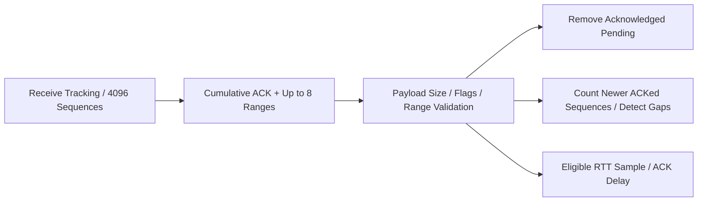
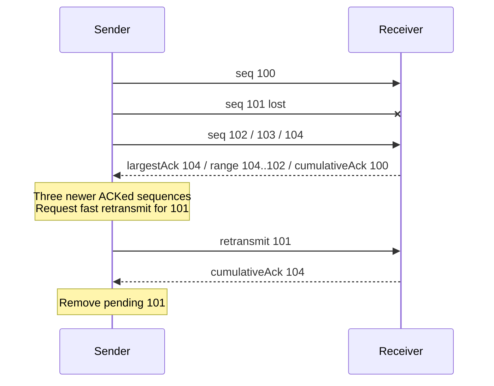

## Reliable Contract Implementation over UDP

이 문서의 핵심 질문은 **“선택된 reliable delivery contract를 UDP 위에서 어떻게 구현하는가?”** 입니다. 어떤 application message가 reliable해야 하는지는 [[Projects/Jam/Networking/02. Transport and Delivery Semantics|Transport and Delivery Semantics]]에서 결정합니다. 여기서는 그 contract를 실현하는 sender/receiver state와 복구 메커니즘만 다룹니다.

Jam은 UDP 전체를 stream으로 바꾸지 않고 `RELIABLE_UNORDERED`와 `RELIABLE_ORDERED` packet만 추적합니다. Sender pending state, receiver ACK window, retransmission, congestion window는 session owner shard에 함께 위치합니다.

**Design Goals**

- 유실된 reliable packet만 다시 보냅니다.
- Ordering이 필요 없는 packet은 gap 뒤에서 기다리지 않습니다.
- ACK packet 수와 ACK latency를 함께 제한합니다.
- 손실이 지속될 때 queue와 memory가 무한 증가하지 않게 합니다.
- Sequence wrap-around에서도 bounded window 안의 비교를 유지합니다.

## Sequence Model

### Recency, Reliability, and Ordering

하나의 sequence number로 세 의미를 표현하면 수신 여부, 최신성, application dispatch 순서가 불필요하게 결합됩니다. Jam은 각 sequence가 하나의 질문에만 답하도록 분리합니다.

| Sequence | 답하는 질문 | 소비하는 메커니즘 |
| --- | --- | --- |
| Recency sequence | 이 update가 지금까지 본 update보다 최신인가? | stale filter |
| Reliability sequence | 이 wire packet을 받았고 ACK했는가? | receive track, ACK, retransmission |
| Order sequence | 이 logical packet을 application handler에 전달할 차례인가? | ordered pending buffer |

### Reliability and Ordering Independence

`RELIABLE_UNORDERED`는 빠진 packet을 복구하되 이미 도착한 독립 event를 dispatch할 수 있어야 합니다. 하나의 sequence가 ACK gap과 dispatch gap을 동시에 뜻하면 reliability만 필요한 message도 앞선 loss를 기다리게 됩니다. 독립 sequence는 loss recovery와 application head-of-line blocking을 분리합니다.

`UNRELIABLE_SEQUENCED`에서 오래된 snapshot은 도착 자체보다 폐기가 올바른 결과입니다. Reliability sequence와 recency를 합치면 ACK/retransmission state가 필요 없는 freshness-only traffic까지 pending delivery에 참여하게 됩니다.

### Fragment Delivery and Logical Packet Order

Fragment는 각각 유실되고 재전송되므로 각자 reliability sequence가 필요합니다. 반면 application ordering은 완성된 logical packet 사이의 관계입니다. `RELIABLE_ORDERED` fragment들은 연속된 order sequence 범위를 차지하고, reassembly가 완료된 뒤 그 전체 span을 한 번에 소비합니다. Sequence 분리는 wire recovery 단위와 application dispatch 단위가 다른 점을 보존합니다.

비용은 header에 channel별 optional sequence가 추가되고 송수신 state가 세 종류로 나뉜다는 것입니다. 대신 각 channel은 필요하지 않은 의미와 처리 비용을 지불하지 않습니다.

## Reliability and Recovery

### Sender Pending State

```text
allocate reliability sequence -> store original packet -> enqueue
    -> transport submission succeeds: record initial send time / inflight bytes
    -> ACK: remove acknowledged pending / update RTT
    -> loss or RTO: enqueue pending packet for retransmission
```

Pending entry는 원본 packet, 최초·최근 전송 시각, 최초 제출 여부, retry count와 재전송 요청·queue 상태를 보관합니다. 최초 enqueue와 실제 transport 제출은 별도 단계입니다. `MarkInitialSend()`는 제출 성공 뒤 최초 송신 시각과 `inflightSize`를 갱신합니다. 이 byte 수는 로컬에서 제출했으나 아직 ACK되지 않은 original reliable byte를 나타냅니다.

### Receiver Tracking and ACK

Receiver는 최근 reliability sequence 4096개를 `ackTrack`으로 추적하고, 이를 cumulative ACK와 최대 8개의 range로 요약하여 전송합니다.

| Wire field | 의미 |
| --- | --- |
| `largestAck` | ACK range를 해석하는 최신 수신 sequence 기준 |
| `cumulativeAck` | `HasCumulativeAck` flag가 있을 때 연속 수신이 확인된 sequence |
| `rangesCount` | 뒤따르는 `AckRange` 개수, 최대 8개 |
| `AckRange.gap` / `length` | 이전 range와의 미수신 간격 / 연속 수신 개수 |
| `ackDelay_us` | ACK 대기 시간, RTT sample 보정에 사용 |

첫 range는 `largestAck`에서 시작하므로 gap이 0입니다. 각 range를 최신 sequence부터 과거 방향으로 해석하고, cumulative ACK가 있으면 해당 지점까지의 연속 수신도 확인합니다. `AckHeader`는 10 bytes, 각 range는 4 bytes입니다.



수신 ACK는 payload 크기, flags, range 개수, 첫 gap, 0이 아닌 length와 추적 범위 안의 coverage를 검증한 뒤 적용합니다. sender는 cumulative ACK 또는 range가 확인한 pending을 제거하고 original in-flight byte를 감소시킵니다. 이미 받은 reliable packet이 재도착하면 application에 중복 전달하지 않고 ACK를 다시 pending으로 표시합니다.

ACK 전송 조건은 pending ACK 유발 packet 2개 또는 20 ms의 delayed ACK timeout입니다. 송신할 datagram에 공간이 있으면 독립 ACK packet을 같은 datagram에 bundle합니다. Datagram 전체 1400 bytes와 scatter part 16개 제한을 확인하며, pending ACK가 due 상태이고 bundle되지 않았다면 ACK-only datagram 제출을 시도합니다.

ACK snapshot은 전송 제출 성공 뒤 소비합니다. 그 사이 ACK coverage나 pending count가 바뀌었다면 새 pending ACK 상태를 유지합니다. ACK 자체가 유실되어도 이후 cumulative/range 정보와 중복 packet에 대한 ACK가 수신 확인을 다시 전달할 수 있습니다.

### Loss Detection and Retransmission



- **Fast retransmit:** ACK coverage에 빠진 pending보다 새로운 수신 확인 sequence가 3개 이상이면 요청합니다. `fastRetransmitUsed`로 같은 pending의 반복 fast 요청을 제한합니다.
- **Timeout:** 최초 제출이 완료되었고 재전송 queue에 들어 있지 않은 pending에서 최근 실제 전송 이후 RTO가 지나면 재전송을 enqueue합니다.

재전송은 `TransmissionWaitingQueue`의 같은 queue에 들어갑니다. `retransmitQueued`가 중복 enqueue를 막고, 제출 성공 시 최근 전송 시각·retry count·recovery metric을 갱신합니다. 제출 실패한 packet은 queue에 남습니다. ACK 후 queue에 남은 reliable packet은 pending 존재 검증에서 제거됩니다.

RTO는 sample이 없을 때 250 ms에서 시작합니다. sample이 있으면 smoothed RTT + 4 × variance를 50 ms–1초로 제한하고 retry count에 따른 backoff를 적용하여 최대 2초로 제한합니다. RTT sample은 최초 제출되었고 재전송되지 않은 ACK 대상에서 선택하며, ACK delay를 반영합니다.

### Transmission Queue and In-Flight Tracking

`TransmissionWaitingQueue`는 단일 deque와 queued byte 수, flush 시각을 관리합니다. Sender는 queue에서 datagram을 구성하고 transport에 제출하며, 성공한 packet을 queue에서 제거합니다. Reliable packet은 peer ACK가 올 때까지 별도의 pending map에 유지됩니다.

`inflightSize`는 실제 제출된 original reliable byte 중 미확인 byte 수를 추적합니다. 최초 송신 성공 때 증가하고 ACK 또는 pending 제거 때 감소합니다. 재전송은 같은 원본에 대한 추가 시도이므로 original byte를 다시 더하지 않습니다. 이 값은 송신량을 차단하는 window가 아닌 추적 상태입니다.

## Delivery Order

### Reliable Unordered

`RELIABLE_UNORDERED`는 duplicate 처리 뒤 즉시 dispatch합니다.

### Reliable Ordered

`RELIABLE_ORDERED`는 expected order sequence보다 앞선 완성 packet을 bounded buffer에 두고, gap이 채워지면 연속 범위를 drain합니다. Fragmented ordered packet은 전체 fragment가 재조립된 뒤 차지한 order span만큼 expected sequence를 전진시킵니다.

## Failure Policy and Bounds

- Reliable delivery가 30초 안에 끝나지 않으면 session을 disconnect합니다.
- Receive tracking 범위를 크게 벗어난 오래된 packet은 폐기합니다.
- Ordered receive buffer는 `OrderState::MaxRecvBufferSize = 256`개로 제한하며, 초과한 out-of-order packet을 폐기합니다.
- Reliable pending 등록은 같은 reliability sequence의 중복을 거부합니다. Receive tracking과 ordered buffer의 제한을 송신 queue 전체의 memory 상한으로 해석해서는 안 됩니다.
- ACK는 transport delivery만 확인하며 handler 성공을 대신하지 않습니다.

## Observability

`NetworkMetrics`는 original reliable transmit, retransmit, ACK packet, ACK된 bytes, retransmit recovery와 timeout을 shard snapshot에 기록합니다. 현재 UDP flush는 bundle된 ACK도 독립 ACK packet으로 `ack_standalone_packets`에 기록합니다. 따라서 이 key만으로 ACK-only datagram 수를 해석할 수 없으며, `ack_piggybacked_packets`를 datagram bundling 횟수로 사용해서도 안 됩니다.


## Trade-offs

Selective reliability는 UDP game traffic 경로를 유지하면서 필요한 packet만 복구합니다. 대신 per-session pending memory, ACK traffic과 timer work가 필요합니다. 송신 queue와 reliable pending의 크기는 workload와 ACK 지연에 영향을 받으므로, 30초 delivery timeout과 함께 pending·전송량·재전송 추이를 관찰해야 합니다. Reliable ordered channel은 손실 시 application-level head-of-line blocking도 감수합니다.

---

### Implementation References

- [`ReliabilityState`, `OrderingState`, `CongestionState`](https://github.com/akxotjr/Jam/blob/master/JamNet/include/jamnet/core/net/SessionComponents.h)
- [ACK processing, retransmission and transmission flush](https://github.com/akxotjr/Jam/blob/master/JamNet/src/core/net/SessionSystems.cpp)
- [RTO, ACK window and congestion algorithms](https://github.com/akxotjr/Jam/blob/master/JamNet/src/core/net/SessionComponents.cpp)
- [Reliability metrics](https://github.com/akxotjr/Jam/blob/master/JamNet/include/jamnet/core/net/NetworkMetrics.h)

### Related

- [[Projects/Jam/Networking/02. Transport and Delivery Semantics|Transport and Delivery Semantics]]
- [[Projects/Jam/Networking/05. Packet Framing and Fragmentation|Packet Framing and Fragmentation]]
