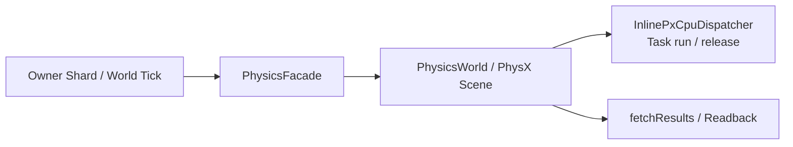
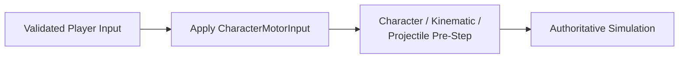
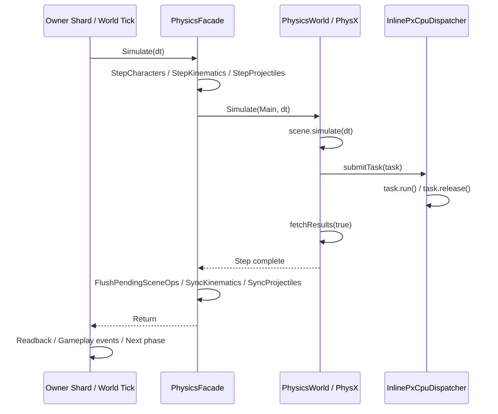
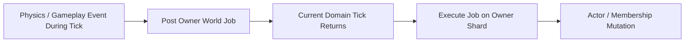
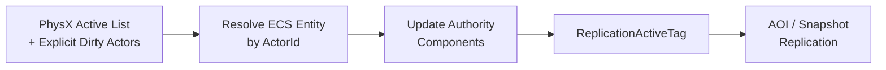

## Facade and Simulation Execution

`PhysicsFacade`는 gameplay-facing 물리 API를 모으고, `PhysicsWorld`는 PhysX scene과 simulation 호출을 관리합니다. world owner shard가 facade를 호출하며, `InlinePxCpuDispatcher`는 PhysX가 제출한 CPU task를 호출 thread에서 `run()`한 뒤 `release()`합니다.



JamPx는 shard scheduler나 fiber await key를 알 필요 없이 simulation을 동기적으로 완료합니다. scene과 actor의 수명, simulation 호출과 결과 반영은 동일한 world ownership 경계에 있습니다.

## World and Scene Ownership

각 physical world는 자신의 `PhysicsFacade`를 통해 PhysX scene과 actor map을 관리합니다. ECS entity와 PhysX actor는 공통 `ActorId`로 연결되며, facade는 rigid body, kinematic, projectile, character controller를 종류별로 보관합니다.

world owner shard가 다음 작업을 수행합니다.

- physics asset registry와 scene 초기화·종료
- actor spawn/despawn과 `ActorId` 연결
- character input과 authoritative state 적용
- simulation 결과 readback
- active actor와 physics event를 ECS 및 gameplay로 반영

PhysX CPU task와 scene 접근이 world 실행 thread에 모이므로 ECS와 physics state의 변경 순서를 명시적으로 유지할 수 있습니다. scene 종료와 actor lifecycle도 owner shard의 tick 경계를 따라 처리합니다.

## Main and Replay Scenes

`PhysicsWorld`는 두 개의 scene slot을 만듭니다.

| Scene | 역할 |
| --- | --- |
| `Main` | server authoritative simulation 또는 client live prediction |
| `Replay` | client reconciliation에서 과거 authoritative state부터 입력을 재실행 |

client correction을 main scene 하나에서 수행하면 live predicted state를 되감고 다시 복구해야 하며, presentation과 query state도 함께 흔들릴 수 있습니다. 별도의 Replay scene은 correction 계산을 live state와 분리합니다.

대신 replay 대상 actor의 state와 resource를 두 scene에 유지해야 하므로 memory와 synchronization 비용이 늘어납니다. Jam은 모든 actor를 무조건 replay 대상으로 보기보다 character와 상호작용 가능성이 있는 archetype을 candidate로 판별하고, Main scene의 gameplay event만 외부로 전달합니다.

## Tick Preparation

PhysX step 이전에는 world state를 scene에 반영합니다.

### Server



server는 physics 결과의 authoritative owner입니다. step 이후 active actor만 읽어 `CharAuthorityState` 또는 `RigidAuthorityState`를 갱신하고 `ReplicationActiveTag`를 표시합니다. 모든 actor를 매 tick 순회하지 않고 PhysX active list와 facade의 dirty set을 결합해 replication 후보를 좁힙니다.

### Client

```text
prepare client physics:
    if reconciliation is required:
        replay inputAck-confirmed correction context in Replay scene
        commit correction result to live state

    push remote authoritative states
    simulate local input in Main scene
    pull Main scene proxy states
```

client physics tick은 `Reconcile()` → `PushAuthorityStates()` → `LivePredict()` → `PullProxyStates()` 순서로 실행합니다. 먼저 authoritative state와 prediction의 위치 오차가 임계값을 넘으면 `inputAck` 이후의 명령을 Replay scene에서 다시 실행하고 correction 결과를 live state에 반영합니다. 이후 remote actor의 authoritative state를 scene에 적용하고, 현재 local input을 Main scene에서 예측한 뒤 proxy state를 읽습니다.

이 차이는 PhysX integration이 단순히 server simulation을 client에서 복제하는 구조가 아니라, server authority와 client responsiveness를 서로 다른 state flow로 연결한다는 점을 보여줍니다.

## Synchronous Simulation Step

`PhysicalWorld`는 shard domain callback에서 world tick을 직접 실행합니다. server와 client physics system은 `PhysicsFacade::Simulate(dt)`를 호출하며, 이 호출이 완료된 뒤 결과를 읽고 다음 phase를 진행합니다.



`Resimulate(dt)`는 Replay scene에 대해 같은 동기 실행 순서를 적용합니다. simulation 동안 shard thread는 physics를 실행하고, 호출이 반환된 뒤 후속 world 처리를 진행합니다. 같은 shard의 mailbox와 다른 domain tick은 현재 domain callback이 끝난 뒤 실행 기회를 얻습니다.

## Safe-Point Scene Mutation

server의 actor spawn/despawn과 membership 작업은 owner shard에서 tick 밖에 수행하도록 검사합니다. physics event처럼 tick 안에서 다음 lifecycle 작업을 유발하는 경로는 world job을 게시하여 현재 callback이 반환된 뒤 처리합니다.



`PhysicsFacade`에는 scene operation의 pending 저장소와 flush 경로가 남아 있지만, 현재 동기 simulation은 호출 thread에서 완료됩니다. 일반적인 world 실행 경계는 tick 전체의 완료이며, lifecycle 작업은 이 경계와 owner 규칙을 따라야 합니다.

## Result Readback and Gameplay Handoff

`PhysicsWorld::Simulate()`는 `fetchResults(true)`로 step 완료를 확정합니다. facade는 pending scene operation과 kinematic/projectile state를 정리하고 반환하며, 이후 physics system이 facade를 통해 결과를 읽습니다.

### Server Result Flow



projectile hit와 lifetime expiry 같은 physics event는 physics system이 수집하여 owner shard의 gameplay 경로로 전달합니다. PhysX callback은 결과 수집 경계로 사용하며, actor와 membership의 구조 변경은 world lifecycle 경계를 따릅니다.

### Client Result Flow

| Scene result | State flow | 소비 목적 |
|---|---|---|
| **Main** | local predicted state/history + remote proxy component update | presentation sampling |
| **Replay** | correction state | prediction reconciliation |

simulation 완료 후 결과를 authoritative component와 client proxy state에 반영합니다. `Simulate → readback → 다음 phase` 순서를 유지하여 같은 tick의 physics 결과가 AOI와 replication의 입력이 되게 합니다.

## Constraints and Trade-offs

- physics 실행 비용은 현재 shard thread가 직접 부담하므로 긴 step은 같은 shard의 mailbox와 다른 world tick을 지연시킵니다.
- 여러 shard의 world는 병렬로 진행하지만, 한 shard 안에서는 world tick과 job을 직렬로 처리합니다.
- inline task 실행은 별도 worker queue와 completion handoff를 줄이고 scene lifetime을 단순하게 유지합니다.
- Main/Replay scene은 client reconciliation을 분리하는 대신 추가 memory와 state synchronization을 요구합니다.
- tick 경계에서 lifecycle 작업을 수행하므로 요청 처리 시점은 현재 callback의 실행 시간에 영향을 받습니다.

world tick과 mailbox 처리 순서는 [[Projects/Jam/Execution Model/03. Owner-Local Serial Execution|Owner-Local Serial Execution]]에서, 일반적인 비동기 continuation 계약은 [[Projects/Jam/Execution Model/05. Fiber-Based Async Scheduling|Fiber-Based Async Scheduling]]에서 설명합니다.

## Implementation References

- [JamNet-facing physics facade](https://github.com/akxotjr/Jam/blob/master/JamPx/include/jampx/PhysicsFacade.h)
- [PhysX scene ownership과 simulation API](https://github.com/akxotjr/Jam/blob/master/JamPx/include/jampx/PhysicsWorld.h)
- [PhysX task의 inline 실행](https://github.com/akxotjr/Jam/blob/master/JamPx/src/jampx/InlinePxCpuDispatcher.cpp)
- [동기 simulation과 Replay 실행](https://github.com/akxotjr/Jam/blob/master/JamPx/src/jampx/PhysicsFacade.cpp)
- [World domain tick 등록과 종료](https://github.com/akxotjr/Jam/blob/master/JamNet/src/runtime/world/simulation/common/PhysicalWorld.cpp)
