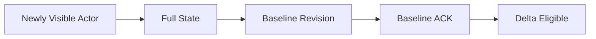
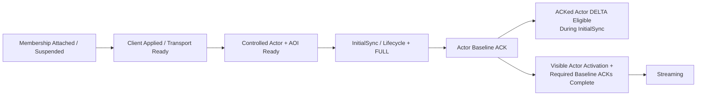

## Per-User Baseline Model

Delta state는 sender와 receiver가 같은 baseline state를 사용할 때만 해석할 수 있습니다. 서버의 baseline 값은 World의 actor별로 공유하며, AOI와 수신 진행 상황에 따른 차이는 user별 delivery/ACK 상태로 관리합니다.

| 소유 범위 | 현재 코드 | 보관하는 정보 |
| --- | --- | --- |
| World의 actor별 shared state | `SharedRigidState`, `SharedCharState` | baseline 값, `fullEpoch`, packed FULL/DELTA와 인코딩 캐시 |
| user별 actor delivery state | `ReplicationUserState::BaselineDeliveryState` | `sentBaselineRev`, `ackedBaselineRev`, `lastSentTick`, `resendCount` |

어떤 user는 actor A의 현재 baseline을 이미 ACK했지만, 다른 user는 방금 AOI에 들어와 FULL부터 받아야 할 수 있습니다. 두 user를 위해 baseline 값 자체를 각각 만들지는 않습니다. 같은 actor baseline을 기준으로 각 user가 어느 revision을 적용했는지 추적합니다. 이 문서의 user별 baseline 관리는 이 delivery/ACK 상태를 뜻합니다.

## Full and Delta State

full state는 독립적으로 actor state를 구성할 수 있는 기준이고, delta state는 현재 baseline과 달라진 부분만 전달합니다.

- shared baseline이 없거나 user의 ACK revision이 현재 `fullEpoch`와 다르면 FULL 송신 또는 재전송 대상이 됩니다. 실제 재전송 시점은 delivery 상태와 재전송 간격에 따릅니다.
- `InitialSync` 또는 `Streaming`에서 user의 `ackedBaselineRev`가 현재 `fullEpoch`와 일치하면 해당 actor의 DELTA 전송을 허용합니다. 실제 DELTA 생성에는 인코딩 전제조건도 만족해야 합니다.

`LocalDrivenKine` rigid actor는 별도 표현 경로를 사용하므로 `CanSendDelta()`에서 actor별 baseline ACK 검사를 생략합니다. 이 예외에도 유효한 epoch와 user phase 검사는 적용됩니다.

Delta state 생성이나 decode 전제조건이 만족되지 않으면 full state로 fallback할 수 있어야 합니다. bandwidth 효율보다 recoverability를 우선하는 경계입니다.

## Baseline ACK

server는 client의 baseline ACK를 받아 해당 user·actor의 delivery 상태를 갱신합니다. 실제 `ServerWorld`도 `BASELINE_ACK` packet을 `ServerReplicationSystem::HandleBaselineFeedback()`으로 전달합니다. user의 ACK가 actor의 shared baseline 값을 바꾸는 것은 아닙니다.

Baseline ACK는 "packet이 도착했다"가 아니라 **해당 baseline revision을 client가 state decode 기준으로 사용할 수 있다**는 synchronization feedback입니다. 따라서 transport ACK와 baseline ACK는 다른 책임을 가집니다.

## Initial Sync

새 user가 world에 attach되면 replication은 `Suspended`로 시작합니다. client world 적용과 transport 준비 뒤 content activation과 replication 재개가 수행됩니다. Player가 준비되어 있으면 `InitialSync`로, 아직 없으면 `AwaitingPlayer`로 전환하며 이후 Player binding 시 initial sync를 시작합니다.

`InitialSync`는 user 전체의 초기 동기화 진행 상태입니다. `CanSendDelta()`는 이 phase에서도 actor별 ACK revision이 현재 shared `fullEpoch`와 일치하면 DELTA를 허용합니다. 따라서 actor A가 ACK되었고 B는 ACK 대기 중이면, A의 DELTA와 B의 FULL 재전송이 같은 `InitialSync` 기간에 진행될 수 있습니다.

`TryCompleteInitialSync()`는 현재 visible actor의 activation과 필요한 baseline ACK가 모두 충족되었는지 확인해 user phase를 `Streaming`으로 바꿉니다. `LocalDrivenKine`은 이 완료 판정에서도 baseline ACK 대기 대상에서 제외합니다. `Streaming` 전환은 모든 actor에 대한 DELTA 전송을 처음 허용하는 전역 barrier가 아닙니다. 이후에도 새로 visible해지거나 baseline epoch가 바뀐 actor는 개별 FULL/ACK 확인이 필요합니다.

membership transaction 자체는 [[Projects/Jam/Game World/01. World Entry and Transition|World Entry and Transition]]에서 설명합니다.

## Budget

replication은 **패킷 하나에 담을 payload와 항목 수**를 제한합니다. snapshot은 AOI의 visible actor 순서로 후보를 수집하며, 각 actor의 baseline ACK·AOI 진입 여부에 따라 FULL/DELTA를 선택합니다. FULL은 재전송 간격을 확인하고, DELTA 경로는 active actor를 대상으로 합니다.

| 제한 | 현재 구현에서의 의미 |
| --- | --- |
| `kPacketPayloadBudget` | `JAMNET_MTU - PacketHeader::HALF_SIZE - 24`를 기준으로 항목의 추정 크기를 누적해 패킷 분할 |
| `kSnapshotBatch = 128` | snapshot 패킷 하나의 최대 actor 수 |
| `kLifecycleBatch = 96` | lifecycle 패킷 하나의 최대 event 수 |
| `kBaselineResendTicks = 10` | 같은 baseline FULL의 재전송 간격 |
| `kBaselineResendBudget = 8` | 재전송 횟수 도달 시 delivery 상태를 초기화하고 FULL을 다시 시도하는 recovery 기준 |

패킷이 차면 다음 패킷을 만들어 같은 tick에서 나머지 후보를 계속 처리합니다. tick의 전체 처리 비용과 송신량은 후보 수와 패킷 수에 따라 증가합니다.

snapshot 패킷 생성·제출에 실패하면 해당 패킷을 보관하지 않고 이후 tick에서 최신 상태를 다시 구성합니다. FULL 송신 기록과 snapshot metric은 session job 제출이 성공한 뒤 갱신합니다. lifecycle은 제출 가능한 pending event를 패킷으로 나누어 시도하며, 실패하면 이후 batch 제출을 중단하고 미제출 event를 다음 tick까지 유지합니다. session job 제출 성공은 transport 전달 완료와 구분합니다.

## Recovery

baseline ACK가 장기간 오지 않거나 revision이 맞지 않으면 full state 재전송 또는 resync가 필요합니다. 이 경로는 정상 delta streaming보다 비싸지만 잘못된 기준으로 delta state를 계속 적용하는 것보다 안전합니다.

## Trade-offs

- actor별 shared baseline과 인코딩 캐시는 baseline 데이터의 user별 중복 보관을 줄입니다. user별 delivery/ACK bookkeeping에는 별도 메모리가 필요합니다.
- full state fallback은 recoverability를 높이지만 순간 bandwidth가 증가할 수 있습니다.
- baseline ACK는 transport reliability와 별도의 protocol state를 추가합니다.
- 패킷 분할에는 패킷별 header와 직렬화 비용이 들며, 전체 tick 비용과 송신량은 후보 수에 따라 증가합니다.

## Implementation References

- [Actor별 shared baseline과 user별 delivery/ACK 상태](https://github.com/akxotjr/Jam/blob/master/JamNet/include/jamnet/runtime/world/simulation/server/ServerReplicationSystem.h)
- [Baseline, delta, resync 구현](https://github.com/akxotjr/Jam/blob/master/JamNet/src/runtime/world/simulation/server/ServerReplicationSystem.cpp)
- [Initial sync와 world pipeline 연결](https://github.com/akxotjr/Jam/blob/master/JamNet/src/runtime/world/simulation/server/ServerWorld.cpp)
