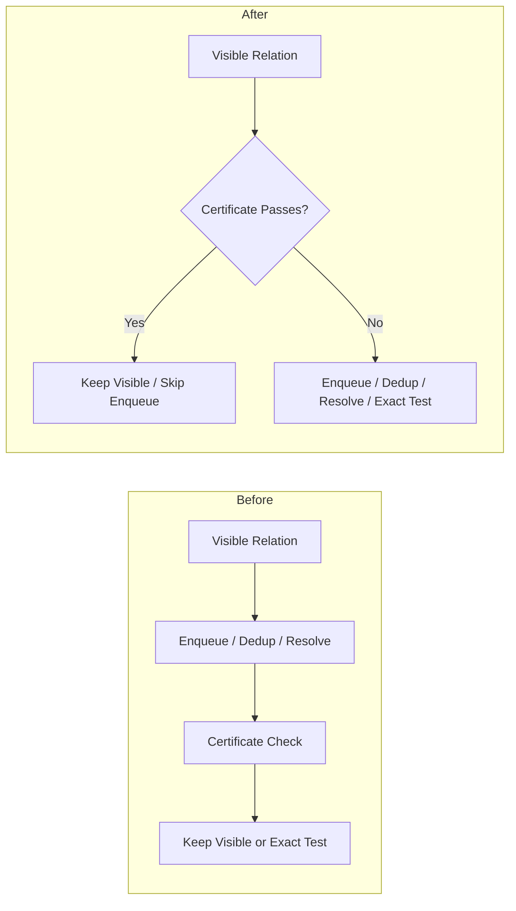
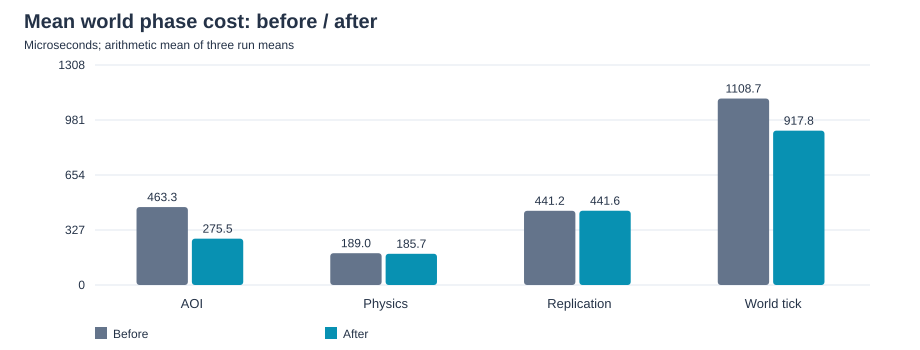
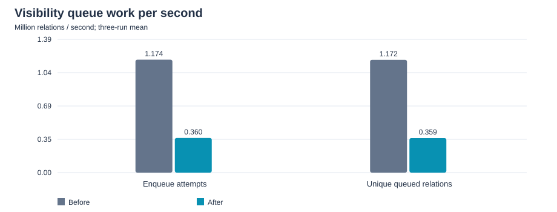

기존 visible relation의 certificate 검사를 visibility queue 등록 앞으로 옮겨 불필요한 queue 작업을 줄였다. 동일한 1,000 Bot workload에서 Before·After를 각각 3회 측정한 결과, **visibility enqueue 시도는 69.32%, AOI 평균 실행 시간은 40.54%, World Tick 평균 실행 시간은 17.22% 감소**했다.

## Problem

기존 구현에도 visibility certificate는 있었다. 마지막 visibility 판정 이후 user와 actor의 이동량으로 가시성 유지를 증명할 수 있으면 정밀 range 판정을 생략했다.

다만 certificate 검사는 relation을 visibility queue에 등록하고 중복 제거·pending 관리·resolve를 거친 뒤 `EvaluateVisibility()`에서 수행했다. 결국 가시성을 다시 계산할 필요가 없는 관계에도 queue 처리 비용이 발생했다. 기존 visible 관계가 많은 workload에서는 정밀 판정 자체를 줄이는 것만으로 이 비용을 없앨 수 없었다.

## Optimization

`EnqueueVisibleRelation()`에서 certificate를 먼저 검사하도록 변경했다. 가시성 유지가 증명되면 기존 membership을 유지하고 queue 등록을 생략한다. 증명하지 못한 관계는 `certificateChecked = true`로 기존 평가 경로에 넘겨 certificate 중복 검사 없이 range·LOS 판정을 수행한다.

certificate는 `AABB_2D`, LOS 비활성화와 유효한 기존 visible membership을 전제로 한다. 후보를 만들기 전에 user·actor의 위치와 누적 이동량을 반영하며, 신규 후보와 certificate 실패 관계에는 정상 visibility 판정을 적용한다. 따라서 최적화의 대상은 가시성이 유지되는 관계의 queue 작업이다.

알고리즘과 수명 계약은 [[Projects/Jam/Game World/04. Area of Interest Management|Area of Interest Management]], 구현은 [AOI precheck 코드](https://github.com/akxotjr/Jam/blob/master/JamNet/src/runtime/world/simulation/server/ServerAoiSystem.cpp)에서 확인할 수 있다.

## Test Configuration

| Item | Configuration |
| --- | --- |
| Purpose | 동일 workload에서 certificate 검사 위치 변경의 효과 비교 |
| Profile / Workload | `target`, 1,000 headless Bot, 10 static Field worlds |
| Bots per World | 초기 약 100명, portal 이동으로 변동 |
| Connection rate | 50 Bot/s |
| Warm-up / Measurement | 3분 / 30분 |
| Repetitions | Before·After 각각 3회, seed 1·2·3 |
| Effective measurement | 반복당 1,795초, 완전히 포함된 5초 window 359개 |
| Server tick | 30 Hz |
| Movement / Portal | 1초 이동·1초 idle traverse, 20–30초 world stay 후 distributed portal |
| Chat | 10초 간격, 64-byte text, World 80% / Direct 20% |
| Execution environment | 별도 server·Bot host, TCP·UDP 사용, synchronous shard physics |
| CPU affinity | offload·global fiber pinning 확인, shard pinning 기록 없음 |
| Server PC | AMD Ryzen 7 7800X3D (8-Core), 64 GB DDR5, Windows 11 |
| Bot PC | AMD Ryzen 7 8845HS, 32 GB LPDDR5, Windows 11 |
| Build Configuration | Server·Bot 모두 Release / x64 |
| Network | 1 Gbps 유선 LAN |
| Network condition | 일반 target 실행; 지정 loss·lag 조건의 impairment 검증은 아님 |

Warm-up과 종료 구간을 제외하고 measurement 안에 완전히 포함된 window만 사용했다. 호스트 간 시계 정렬을 전제로 하며 독립적인 clock offset 검증은 하지 않았다. 과거 [[Projects/M1/04. Baseline Measurement|300 Bot Baseline]]과 하드웨어·OS·빌드 구성은 동일하지만, 네트워크는 Wi-Fi에서 1 Gbps 유선 LAN으로 변경했다. Profile·affinity·시간 조건도 달라 300 Bot 결과를 직접적인 최적화 전후 비교에 사용하지 않았다.

Counter rate는 유효 구간 합계 / 1,795초로 계산했다. 아래 **평균 비교는 run별 평균 3개의 산술평균**이며, **p99는 각 run의 유효 구간에 속한 10개 world 전체 표본을 합친 분포**에서 계산했다. 세 run의 p99를 합산하거나 평균하지 않았다.

## Performance Comparison

### Mean Cost and Queue Work

| Metric | Before: 3-run mean | After: 3-run mean | Change |
| --- | --- | --- | --- |
| AOI mean (μs) | 463.3 | 275.5 | 40.54% 감소 |
| World Tick mean (μs) | 1108.7 | 917.8 | 17.22% 감소 |
| Enqueue attempts (M/s) | 1.174 | 0.360 | 69.32% 감소 |
| Unique queued relations (M/s) | 1.172 | 0.359 | 69.38% 감소 |

AOI 평균 감소량 약 187.8 μs는 World Tick 평균 감소량 약 190.9 μs와 가까웠다. Physics 평균은 189.0 → 185.7 μs, Replication 평균은 441.2 → 441.6 μs로, 비용 감소가 AOI phase에 집중되었다.

After는 초당 824.2–825.5k회의 certificate precheck 중 **98.466–98.470%**에서 enqueue를 생략했다. 기존 평가 단계의 `certificate_early_returns`는 Before 초당 812.6–813.7k회에서 After 523.4–524.0회로 줄었다. 가시성 유지 판정의 대부분이 queue 등록 앞으로 이동했음을 보여준다. `unique_relations`는 queue 등록 수이며 정밀 range·LOS 검사 횟수와는 구분한다.

### Tail Latency

| Version / Run | AOI mean / p99 (μs) | World Tick mean / p99 (μs) | World Tick max (ms) |
| --- | --- | --- | --- |
| Before 1 | 462.6 / 847 | 1108.7 / 1963 | 6.511 |
| Before 2 | 472.5 / 858 | 1120.8 / 2018 | 7.043 |
| Before 3 | 455.0 / 820 | 1096.5 / 1968 | 6.155 |
| After 1 | 274.9 / 513 | 917.6 / 1675 | 5.635 |
| After 2 | 275.4 / 503 | 917.5 / 1663 | 6.215 |
| After 3 | 276.2 / 515 | 918.2 / 1669 | 6.011 |

AOI p99는 Before 820–858 μs에서 After 503–515 μs로, World Tick p99는 1.963–2.018 ms에서 1.663–1.675 ms로 낮아졌다. 각 범위는 세 run의 개별 p99를 나타낸다. 평균과 p99 모두 개선되었지만 max는 반복 간 변동과 범위 겹침이 있어 같은 비율의 개선을 주장하지 않는다.

### Workload Consistency

| Metric | Before range | After range |
| --- | --- | --- |
| AOI neighbors mean | 32.88–32.92 | 32.83–32.91 |
| Snapshot actor entries (k/s) | 602.89–603.64 | 602.04–602.81 |
| Lifecycle events (/s) | 4098.3–4106.7 | 4097.0–4105.6 |
| Process TX (MB/s) | 27.917–27.943 | 27.886–27.920 |
| Replication mean (μs) | 438.2–443.1 | 441.2–441.8 |

측정 중 Bot 상태 표본은 모두 `running=1000`, `failed=0`이었고 portal timeout·unexpected world·chat rejection도 0이었다. AOI 밀도와 replication 처리량이 유사한 조건에서 queue 작업과 AOI 시간이 감소했다. 다만 같은 seed를 사용해도 모든 tick의 spatial trajectory가 동일하다는 의미는 아니다.

## Interpretation and Limitations

기존 visible 관계의 queue 작업을 줄인 변경과 enqueue·AOI 비용 감소가 일치하며, AOI phase의 감소량이 World Tick 평균 개선의 대부분을 설명한다. 이는 이번 workload에서 certificate 검사 위치가 유효한 최적화 지점이었음을 지지한다.

| Recovery metric | Before range | After range |
| --- | --- | --- |
| RTX packets (/s) | 1.17–3.69 | 4.95–5.59 |
| Baseline resends (/s) | 1.98–6.33 | 8.98–10.17 |
| Pending reliable peak | 424–435 | 436–466 |

World Tick overrun, reliable give-up, baseline full request와 baseline resync는 전 run에서 0이었다. 다만 After의 재전송·baseline resend·pending peak는 높아졌다. Before 3회 뒤 After 3회를 실행한 순차 실험이므로 시간대·network 변동과 version 효과를 완전히 분리할 수 없으며, 이 증가를 precheck의 인과 효과로 단정하지 않는다.

이번 결과는 headless Bot과 memory store를 사용하는 정상 부하의 비교다. 실제 DB I/O, Unity rendering, 장애 환경과 최대 수용 CCU는 검증 범위에 포함하지 않는다. After의 전체 실행 비용과 추가 개선 대상은 [[Projects/M1/07. 1000 CCU After Analysis|1,000 CCU Performance Analysis]]에서 다룬다.
