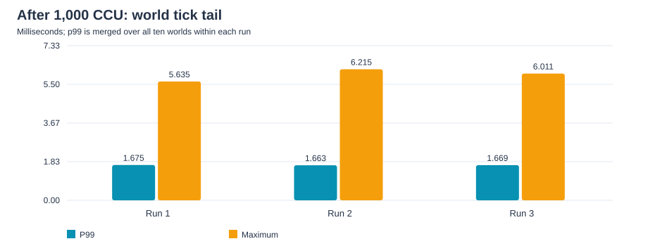
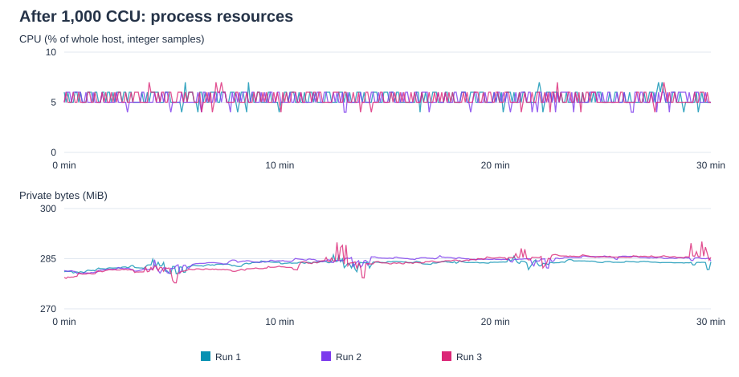

AOI precheck 최적화를 반영한 서버에서 1,000 CCU workload를 30분씩 3회 실행했다. **World Tick의 run별 p99는 1.663–1.675 ms, 전체 관측 max는 6.215 ms였으며, Tick overrun과 reliable give-up은 0이었다.** 이 문서는 해당 부하의 안정성, 주요 실행 비용과 추가 분석 대상을 정리한다.

## Test Overview

| Item | Configuration |
| --- | --- |
| Purpose | 최적화 이후 1,000 CCU workload의 반복 안정성과 subsystem 비용 확인 |
| Workload | `target`, 1,000 headless Bot, 10 static Field worlds |
| Bots per World | 초기 약 100명, portal 이동에 따라 변동 |
| Connection rate | 50 Bot/s |
| Warm-up / Measurement | 3분 / 30분 × 3회, seed 1·2·3 |
| Effective measurement | 반복당 1,795초, 완전히 포함된 5초 window 359개 |
| Server tick | 30 Hz |
| Gameplay | traverse 이동·idle, distributed portal, World·Direct chat |
| Execution environment | 별도 server·Bot host, TCP·UDP 사용, synchronous shard physics |
| CPU affinity | offload·global fiber pinning 확인, shard pinning 기록 없음 |
| Server PC | AMD Ryzen 7 7800X3D (8-Core), 64 GB DDR5, Windows 11 |
| Bot PC | AMD Ryzen 7 8845HS, 32 GB LPDDR5, Windows 11 |
| Build Configuration | Server·Bot 모두 Release / x64 |
| Network | 1 Gbps 유선 LAN |
| Network condition | 일반 target 실행; 지정 loss·lag 조건의 impairment 검증은 아님 |

Warm-up·종료 구간과 measurement 경계에 걸친 window를 제외했다. 호스트 간 시계 정렬을 전제로 하며 clock offset은 독립 검증하지 않았다. 상세 workload와 최적화 전후의 차이는 [[Projects/M1/06. AOI Precheck Before and After|AOI Precheck Before and After]]에서 설명한다.

Percentile은 각 run의 유효 구간 전체를 대상으로 한다. **Merged p99**는 해당 run의 10개 world 전체 표본을 합친 percentile이고, **worst-world p99**는 world별 percentile 중 최댓값이다. 세 run 전체를 합친 p99나 window별 p99의 평균과 구분한다. Max는 각 run의 유효 구간에서 가장 큰 sample이다. 네트워크 rate는 decimal MB/s·k/s, memory는 MiB를 사용한다.

## Stability Summary

| Metric | Three-run observation |
| --- | --- |
| World Tick merged p99 | run별 1.663–1.675 ms |
| Worst-world tick p99 | run별 1.746–1.766 ms |
| World Tick maximum | 3개 run의 유효 구간 전체에서 6.215 ms |
| World Tick overrun | 전 run 0 |
| Reliable give-up | 전 run 0 |
| Baseline full request / resync | 전 run 0 / 0 |
| Bot state samples | 전 run `running=1000`, `failed=0` |
| Portal timeout / Unexpected world / Chat rejection | 전 run 0 / 0 / 0 |

30 Hz Tick Budget은 약 33.33 ms다. 전체 관측 max 6.215 ms는 budget의 약 18.6%였으며, 선택 구간의 histogram overflow도 0이었다. 해당 workload에서 tick budget 안의 반복 동작을 확인했지만 최대 수용 CCU를 검증한 결과는 아니다.

Server의 `active_sessions`는 2,000으로 유지되었다. **1,000 Bot 각각의 TCP·UDP transport session을 합산한 값**으로, 2,000 CCU를 의미하지 않는다. Bot 상태는 주기적 관측 표본이므로 모든 순간의 world participant 상태를 직접 증명하는 값과도 구분한다.

측정 후 종료 과정에서는 한 차례 실행에 membership cleanup 재시도와 enter failure warning이 각각 1회 있었다. 세 번 모두 정상 종료했지만, 부하 구간의 안정성과 종료 시 lifecycle 정리는 별도로 확인할 사항이다.

## World Tick Performance

| Metric | Run 1 | Run 2 | Run 3 |
| --- | --- | --- | --- |
| Mean (μs) | 917.6 | 917.5 | 918.2 |
| Merged p95 / p99 (μs) | 1291 / 1675 | 1278 / 1663 | 1290 / 1669 |
| Worst-world p99 (μs) | 1766 | 1746 | 1762 |
| Max (ms) | 5.635 | 6.215 | 6.011 |

평균은 세 run에서 약 0.918 ms로 재현되었고, p99도 비슷한 범위를 유지했다. 평균·p99와 max를 함께 보면 일반적인 tail과 간헐적인 최대 지연을 구분할 수 있다. Tick duration은 world pipeline 실행 시간이며 packet·RPC 또는 end-to-end latency를 의미하지 않는다.

### Subsystem Cost

| Phase | Mean across runs (μs) | Share of mean tick | Run별 merged p99 범위 (μs) |
| --- | --- | --- | --- |
| Input | 13.5 | 1.5% | 27–27 |
| Physics | 185.7 | 20.2% | 340–342 |
| AOI | 275.5 | 30.0% | 503–515 |
| Replication | 441.6 | 48.1% | 816–823 |

각 phase 평균은 run별 전체 world 표본의 평균을 구한 뒤 세 run을 산술평균한 값이다. **비중의 분모는 같은 방식으로 계산한 World Tick 평균 약 917.8 μs**다. 서로 다른 phase의 p99를 더하거나 평균하여 전체 tick p99를 계산하지 않는다.

AOI 최적화 이후 **Replication이 평균 tick의 약 48.1%로 가장 큰 실행 비용**을 차지했다. 다음 성능 분석은 encoding과 user별 fan-out의 비용을 구분하는 데 집중할 수 있다. Phase 합계와 tick 전체에는 호출·계측 경계와 시간 단위 양자화에 따른 작은 차이가 있다. 현재 `finalize_duration`은 0으로 기록되어 별도 작업 비용으로 해석하지 않는다.

## Shard and Executor Analysis

| Shard | Worlds | Mean tick range (μs) | Per-world p99 range (μs) | Mean Mailbox Ready Wait (ms) |
| --- | --- | --- | --- | --- |
| 0 | 2 | 914.7–924.4 | 1573–1609 | 0.513–0.540 |
| 1 | 3 | 908.8–923.0 | 1627–1762 | 1.160–1.259 |
| 2 | 2 | 923.4–925.6 | 1640–1715 | 0.464–0.583 |
| 3 | 3 | 909.2–917.7 | 1641–1766 | 1.296–1.319 |

Shard mean은 각 run에서 해당 shard의 world tick 표본을 함께 집계한 평균의 범위다. Per-world p99 범위는 해당 shard의 world별·run별 p99를 모은 범위이며 shard 전체의 merged p99와 다르다.

10개 world는 **2 / 3 / 2 / 3**개로 배치되었다. World당 participant 평균은 대체로 100명이었고 portal 이동 중 관측 범위는 69–125명이었다. Configured capacity 400명에 비해 낮은 분포이므로 단일 world capacity 경계까지 검증한 workload는 아니다.

Mailbox Ready Wait는 ready 게시부터 shard가 mailbox를 service할 때까지의 대기다. 평균은 대기 시간 합계 / 표본 수로 계산했으며, world가 3개인 shard에서 더 길게 관측되었다. 다만 User·session 배치와 traffic도 영향을 주므로 world 수만의 인과 효과로 단정할 수 없다.

| Executor observation | Result |
| --- | --- |
| Mailbox Ready Wait max | run별 12.830 / 11.203 / 14.370 ms |
| Executor catch-up limit events | run별 약 18.4만–18.6만 회 |

Mailbox 최대 대기는 tick p99보다 훨씬 길었다. 따라서 world tick 실행 시간의 여유만으로 제어 요청의 tail latency까지 판단할 수 없다.

`tick_catch_up_count`는 executor의 전체 domain에서 catch-up 한도를 넘겨 다음 예정 시각을 조정한 횟수로, **World Tick overrun과 다른 지표**다. 큰 수치가 관측되었으며 현재 집계로는 domain별 원인을 분리할 수 없다. 정상으로 간주하기보다 domain별 예정 시각 지연·처리 비용과 mailbox tail의 상관관계를 후속 분석 대상으로 둔다. Shard loop와 boundary service의 계약은 [[Projects/Jam/Execution Model/03. Owner-Local Serial Execution|Owner-Local Serial Execution]]에서 설명한다.

## Network and Resource Usage

### Replication and Network

| Metric | Three-run range |
| --- | --- |
| AOI neighbors mean / p99 | 32.83–32.91 / 57–58 actor |
| Snapshot actor entries | 602.04–602.81k/s |
| Snapshot FULL / DELTA entries | 5.46–5.47k/s / 596.57–597.35k/s |
| Lifecycle events | 4097.0–4105.6/s |
| Process TX / RX | 27.886–27.920 MB/s / 약 2.397 MB/s |
| RTX packets | 4.95–5.59/s |
| Baseline resends | 8.98–10.17/s |
| Pending reliable peak | 436–466 |

Snapshot actor entry는 user별 fan-out을 합한 전송 항목 수이며 고유 actor 수가 아니다. DELTA 비중은 약 99.1%였다. 지속적인 movement·portal 전환과 lifecycle 처리가 있는 workload에서 이 처리량이 재현되었다.

Snapshot bytes는 25.584–25.614 MB/s로 process TX의 약 91.7%를 차지했다. 다만 두 계층의 byte 정의 차이가 있으므로 나머지를 wire overhead만으로 해석하지 않는다. Process TX도 Ethernet/IP 전체 bandwidth와 구분한다.

재전송과 baseline resend가 발생했지만 reliable give-up, full request와 resync는 0이었다. Before보다 recovery rate가 높았다는 관측과 그 한계는 [[Projects/M1/06. AOI Precheck Before and After|AOI Precheck Before and After]]에 정리했다. 지정 packet loss·lag를 적용한 결과가 아니므로 이 수치로 실측 loss rate나 장애 환경의 안정성을 주장하지 않는다.

### CPU and Memory

| Metric | Run 1 | Run 2 | Run 3 |
| --- | --- | --- | --- |
| Process CPU mean / max (%) | 5.42 / 7 | 5.34 / 6 | 5.38 / 7 |
| Working set mean (MiB) | 216.8 | 213.2 | 213.0 |
| Private bytes mean (MiB) | 283.4 | 284.2 | 283.7 |
| Private bytes first → last (MiB) | 281.1 → 284.0 | 281.5 → 284.3 | 279.4 → 285.4 |

CPU는 전체 host CPU time으로 정규화된 정수 percent 표본의 평균·최댓값이다. 약 5.3–5.4%의 평균만으로 특정 shard의 여유나 최대 CCU를 선형 외삽하지 않는다.

Private bytes는 유효 구간 첫·마지막 표본 사이 약 2.9–6.0 MiB 증가했다. 메모리가 완전히 평탄하다고 볼 수 없으며, 30분 결과만으로 leak 유무를 판단하지 않는다. 더 긴 steady-state와 반복 disconnect/reconnect 이후의 회복 여부를 확인해야 한다. Metric의 상세 정의는 [[Projects/Jam/Observability/03. Metric Catalog|Metric Catalog]]를 참조한다.

## Findings and Next Steps

- **Tick 안정성:** 1,000 CCU·10 worlds에서 30분 × 3회 동안 World Tick overrun과 reliable give-up은 0이었다. 최대 수용 규모에 대한 결론은 내리지 않는다.
- **다음 비용 분석 대상:** AOI 최적화 이후 평균 비용의 약 48.1%가 Replication에 있었다. Encoding과 fan-out을 나누어 분석하고 density 증가 시 비용을 확인한다.
- **Shard 간 대기 차이:** Mailbox Ready Wait 평균은 shard별로 차이가 있었고 max는 14.370 ms였다. World·User·session 배치를 함께 관찰하여 부하 편중 가능성을 검증한다.
- **Executor 추가 분석:** 많은 catch-up limit event를 domain별 지연·처리 비용으로 분해하여 원인을 확인한다.
- **검증 확대:** 장시간 memory 추이, 종료 시 membership 정리, 장애 환경과 CCU·world 밀도 증가 조건을 확인한다. 실제 DB I/O와 Unity rendering은 별도 검증 범위다.
